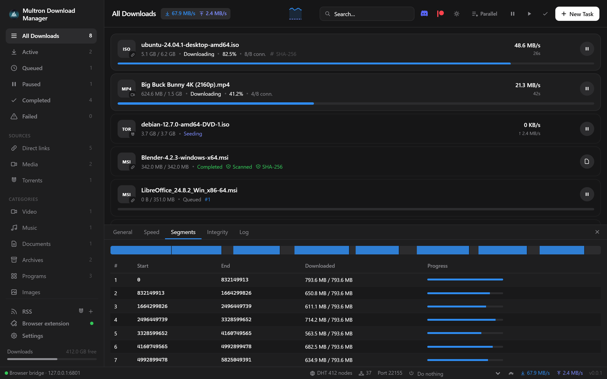
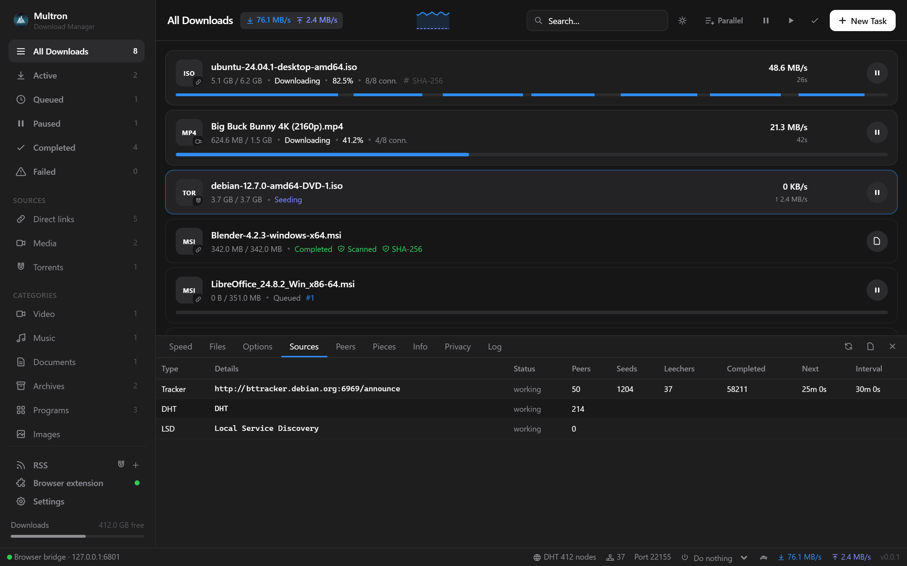
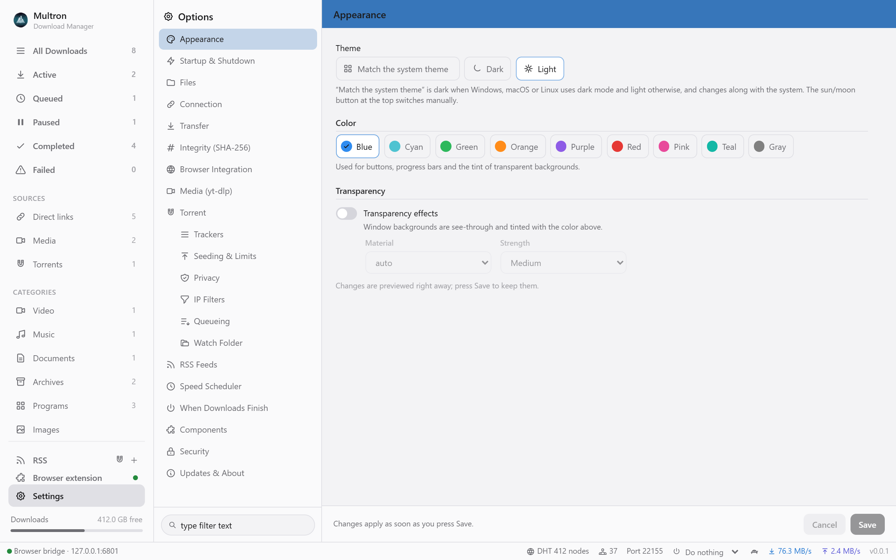
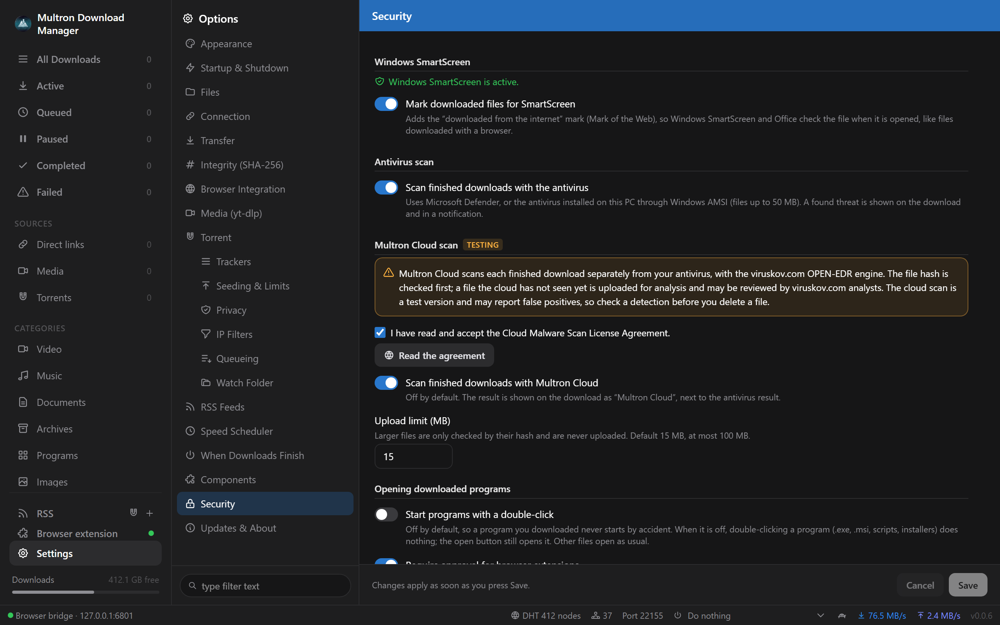
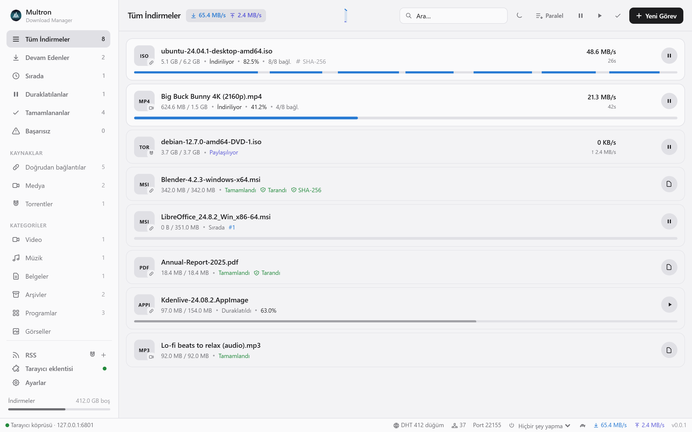

<p align="center">
  
</p>

<h1 align="center">Multron Download Manager</h1>

<p align="center">
  A fast, multi-connection download manager written in Rust — direct links, videos from YouTube / Reddit / Instagram and 1,800+ other sites, Google Drive & MEGA files, and a full BitTorrent client, in one lightweight desktop app.
</p>

<p align="center">
  
  
  
  
  
  
</p>

<p align="center">
  
</p>

---

## Contents

- [Screenshots](#screenshots)
- [Features](#features)
- [Install](#install)
- [Browser extension](#browser-extension)
- [How the download engine works](#how-the-download-engine-works)
- [Supported sources](#supported-sources)
- [Torrents](#torrents)
- [SHA-256 verification](#sha-256-verification)
- [Settings overview](#settings-overview)
- [Building from source](#building-from-source)
- [Releasing](#releasing)
- [Project structure](#project-structure)
- [Translating](#translating)
- [Security & privacy](#security--privacy)
- [License](#license)

---

## Screenshots

| | |
|---|---|
|  |  |
| **Downloads** — every connection writes to its own range; the progress bar fills from start to end, and the *Segments* tab shows each connection’s range live. | **Torrents** — seeding with tracker, DHT and LSD sources, peers, pieces and more. |
|  |  |
| **Appearance** — light, dark or system theme, accent colours and transparency. | **Security** — SmartScreen mark, antivirus scan, Multron Cloud scan (testing), safe opening of programs, extension approval, TLS and redirect rules. |
|  | |
| **12 languages** — follows the system language (Turkish shown here). | |

---

## Features

**Speed**
- **Multi-connection downloads** — every file is split into parallel byte ranges, **8 connections by default**, adjustable from 1 to 64 globally or per download, even while it is running.
- **Work stealing** — when a connection finishes its range it takes over half of the largest remaining range, so all connections stay busy until the last byte and slow mirrors never hold a download back.
- **Direct-to-disk writes** — the file is pre-allocated (sparse on NTFS, so there are no zero-fill stalls; real space reservation with `fallocate` / `F_PREALLOCATE` on Linux and macOS) and every connection writes straight to its final offset. There is no merge step: when the last byte lands, the file is done.
- **Disk space check** — a download that does not fit on the drive stops before it starts, with a clear message, instead of failing near the end.
- **Safe resume** — the server's ETag / Last-Modified is stored and sent with `If-Range` on every range request. If the file changed on the server, Multron Download Manager starts over instead of mixing two versions; every range response is also checked against the requested offset and total size.
- **One TCP connection per range** — HTTP/1.1 is forced for downloads so ranges are not squeezed into a single HTTP/2 socket.
- Resume after pause, crash or restart; automatic retries with back-off; per-download and global speed limits (unlimited by default).
- **Survives network changes** — when the connection drops (turning a VPN or GoodbyeDPI on or off, Wi-Fi switching), the download shows *Waiting for the network*, waits until the site is reachable again and continues with fresh links (*Reconnecting*). Video streams whose pieces arrive broken are thrown away and fetched again instead of failing with an FFmpeg error.

**Queue & speed control**
- **Sequential mode** — one click on **Parallel / One at a time** in the toolbar downloads files one after another instead of side by side.
- **Reorder the queue** — every queued download shows its place (`#1`, `#2`…); the ↑ / ↓ buttons move it (double-click: to the top / bottom).
- **Per-download speed limit** — the gauge button on a download offers Unlimited, 256 KB/s, 512 KB/s, 1, 2, 5 or 10 MB/s, so you can split your bandwidth between downloads. A limited download shows a `≤ 1 MB/s` badge.

**Managing the list**
- **Select several downloads** — Ctrl+click (⌘+click on macOS) picks single downloads, Shift+click picks a range and Ctrl+A picks everything in the current view. A bar above the list then offers *Pause*, *Resume* and *Remove* for all of them; **Delete** removes the selection and **Esc** clears it.
- **Clear the list** — the ✓ button in the toolbar opens *Clear finished*, *Clear failed* and *Clear all…*. Removing several downloads asks once and can delete the downloaded files too.
- **Deleting from disk is thorough** — unfinished media downloads also lose yt-dlp's temporary pieces (`.part`, fragments, separate video and audio streams), and a file that is still open in another program or being scanned is retried for a few seconds. If it still cannot be deleted, Multron Download Manager says which file is left.

**Everything in one app**
- Direct HTTP/HTTPS downloads with queueing (configurable number of simultaneous downloads).
- Media downloads through **yt-dlp** — YouTube (incl. Shorts & playlists), Reddit, Instagram, X/Twitter, TikTok, Facebook, Vimeo, Twitch, SoundCloud and many more. Pick 4K / 1080p / 720p / … or audio-only MP3/M4A.
  - YouTube is downloaded **without your browser cookies** first, because YouTube rejects copied session cookies ("The page needs to be reloaded"). The cookies are used only when YouTube asks to sign in (age-restricted, private or members-only videos). Other sites use the cookies first and retry without them if the site rejects them.
  - The real video title is shown right away, even when the page only says "YouTube".
  - **MP4 plays everywhere** — with the MP4 container, *Best quality* picks H.264 video and AAC audio (on YouTube usually up to 1080p), which every player and Windows Films & TV can show. YouTube offers 1440p and 4K only as VP9/AV1; pick those resolutions explicitly to get them (they need a player with VP9/AV1 support, or MKV).
- Share-link resolvers for **Google Drive** (incl. large-file confirmation and Docs/Sheets/Slides export), **MEGA** (decrypted on the fly with AES-128-CTR), **Dropbox**, **MediaFire**, **Pixeldrain** and **GitHub**.
- A built-in **BitTorrent client** (librqbit): magnet links, .torrent files, file selection, DHT, uTP, UPnP, LSD, trackers, seeding rules, IP filters, SOCKS5 proxy and a BiglyBT-style detail view (Speed, Files, Options, Sources, Peers, Pieces, Info, Privacy, Log).
- **SHA-256 verification** — optionally asks for the expected hash of every file and verifies it automatically when the download finishes.

**Appearance**
- **Light and dark themes**, or **Match the system theme** (follows Windows, macOS and Linux and switches with them). The sun/moon button in the toolbar switches manually.
- **Nine accent colors** — Blue (default), Cyan, Green, Orange, Purple, Red, Pink, Teal and Gray — used for buttons, progress bars and the tint of transparent backgrounds.
- **Transparency effects** with three strengths (Light, Medium, Strong): **Acrylic** or **Mica** on Windows 11, Blur on Windows 10, vibrancy on macOS. Linux keeps solid backgrounds; theme and colors still apply.

**Safety**
- **Antivirus and SmartScreen** — finished files get the "downloaded from the internet" mark and are scanned with Microsoft Defender or the installed antivirus (Windows); see [Security & privacy](#security--privacy).
- **Multron Cloud scan (testing)** — optional and off by default: finished downloads are also scanned separately in the cloud and shown with their own **Multron Cloud** badge. Only files the cloud has not seen are uploaded, up to 15 MB by default (adjustable up to 100 MB).
- **Click a scan badge to see why** a file was not scanned, or what was found.
- **No accidental program starts** — double-clicking a downloaded program does not run it unless you turn that on.

**Desktop integration**
- Runs in the **background** with a tray icon; closing the window keeps downloads, seeding and the browser bridge alive.
- **Portable Windows version** — extract the portable zip anywhere (also a USB stick); settings and the download list stay in its `data` folder, and it updates itself in place.
- **Start with the system** — *Start with Windows*, *Open at login* on macOS (Login Items) or an autostart entry on Linux (GNOME, KDE, Xfce…), starting hidden in the tray.
- **Progress on the taskbar** — while files download, the Multron Download Manager button on the Windows taskbar (the Dock icon on macOS) fills with the overall progress and gets a spinning ring in its bottom-right corner (in your accent color); the tray icon gets the same ring and its tooltip shows the percentage and speed. When a download finishes, fails or a threat is found while Multron Download Manager is in the background, its taskbar button flashes.
- Notifications, drag & drop of .torrent files, paste a link anywhere to add it.
- **Mandatory updates** — when Multron Download Manager starts it checks GitHub Releases; if a new version exists it shows *Updating Multron Download Manager to x.y.z* with the download progress, checks the release's signed `update.json` and the file's SHA-256 (see [How updates are verified](#how-updates-are-verified)), installs it and restarts before the app can be used. Without an internet connection Multron Download Manager starts normally and tries again next time; if the download fails three times it lets you continue and retries at the next start. Releases found while Multron Download Manager runs are downloaded in the background and installed when it quits. Development builds never update themselves.
- **Version check** for the app and for yt-dlp from inside the app (Settings → Updates & About).
- **Community links** — the Discord and Patreon buttons in the toolbar (also in *Settings → Updates & About*) open the [Multron Download Manager Discord server](https://discord.gg/xXmQw3MUAR) and [Multron Download Manager on Patreon](https://www.patreon.com/cw/multron).
- **Languages from language files** — follows the Windows / macOS / Linux language by default (English when there is no translation) — English, Turkish, German, French, Spanish, Italian, Portuguese (Brazil), Russian, Japanese, Chinese (Simplified), Chinese (Traditional) and Korean; a language can also be picked by hand. Translations live in `frontend/src/lang/<code>.json` (see [Translating](#translating)).

---

## Install

Download the file for your system from the [latest release](https://github.com/Multron-Community/Multron-Download-Manager/releases/latest). Every release contains all platforms:

| Platform | File | Install |
| --- | --- | --- |
| Windows 10/11 x64 | `Multron-Download-Manager-<version>-x64-Setup.exe` | Run the installer (Inno Setup). It installs WebView2 if it is missing, and can associate `.torrent` files and `magnet:` links. |
| Windows 10/11 x64, portable | `Multron-Download-Manager-<version>-x64-portable.zip` | Extract it anywhere (also a USB stick) and run `multron-download-manager.exe`. Settings and the download list stay in the `data` folder next to it, and it updates itself in place. Needs WebView2, which Windows 10/11 normally already have. |
| macOS Apple Silicon | `*_aarch64.dmg` | Open the DMG and drag the app to Applications. |
| macOS Intel | `*_x64.dmg` | Same as above. |
| Ubuntu 24.04+ / Mint 22+ / Debian 13+ (apt) | `*_amd64.deb` (or `*_arm64.deb`) | `sudo apt install ./<file>.deb` |
| Debian 12 bookworm / LMDE 6 (apt) | `*_debian12_amd64.deb` (or `*_debian12_arm64.deb`) | `sudo apt install ./<file>.deb` |
| Fedora 43+ (dnf) | `*_fedora_x86_64.rpm` (or `*_fedora_aarch64.rpm`) | `sudo dnf install ./<file>.rpm` |
| openSUSE Leap 16 / Tumbleweed (zypper) | `*_opensuse_x86_64.rpm` (or `*_opensuse_aarch64.rpm`) | `sudo zypper install --allow-unsigned-rpm ./<file>.rpm` |
| Any Linux | `*_amd64.AppImage` (or `*_aarch64.AppImage`) | `chmod +x <file>.AppImage && ./<file>.AppImage` |
| Browser extension | `multron-browser-extension-chromium-v<version>.zip` (Chrome, Edge, Brave, Opera, Vivaldi) or `multron-browser-extension-firefox-v<version>.zip` | See [Browser extension](#browser-extension). |

Every release has a signed `update.json` that lists the SHA-256 of each file. Check a download with `node scripts/verify-update.mjs update.json update.json.sig <file>` from this repository, or check where it was built with `gh attestation verify <file> --repo Multron-Community/Multron-Download-Manager` (see [How updates are verified](#how-updates-are-verified)).

> **Linux:** every package is built on the distribution it is meant for. The plain `.deb` and the AppImage are built on Ubuntu 24.04 and need glibc 2.39 or newer (Ubuntu 24.04+, Linux Mint 22+, Debian 13+). Debian 12 (bookworm) and LMDE 6 have their own `.deb` built on Debian 12, Fedora has its own `.rpm` built on Fedora 43, and openSUSE has its own `.rpm` built on Leap 16 (it also runs on Tumbleweed). Automatic updates keep each installation on the package built for its distribution. Older releases such as Ubuntu 22.04 or Linux Mint 21 are not supported.

> **macOS:** builds are not notarized yet. Right-click the app → **Open** the first time, or run `xattr -cr "/Applications/Multron Download Manager.app"`.

**External tools** — nothing needs to be installed by hand:
- **yt-dlp** is downloaded from its latest GitHub release into the app's data folder on first use (no Python required).
- **Always up to date** — Multron Download Manager checks yt-dlp and the FFmpeg it installed when it starts and every 6 hours, and updates them while no video is downloading (otherwise it tries again 30 minutes later). The new FFmpeg is unpacked next to the old one and swapped in only when it is complete. On Windows and Linux FFmpeg is refreshed at most once a week, because its builds change daily; on macOS when a new release is out. An FFmpeg from the system package manager is left to the package manager.
- **FFmpeg** (needed because most sites, YouTube included, serve video and audio as separate streams, and for MP3 conversion) is installed automatically on the first media download on Windows, macOS and Linux (x86_64 and arm64, also from the AppImage), or from *Settings → Media*. An FFmpeg that is already installed on the system is used instead.
- Both are downloaded with the same multi-connection engine as your files. While FFmpeg installs, the download shows its own status (`FFmpeg: 61 MB / 142 MB · Installing FFmpeg · 43%`, then *Extracting FFmpeg*), and pause or remove stops the install. If the install fails, a warning says why and the video is saved in a lower quality.

---

## Browser extension

The extension (any Chromium-based browser — Chrome, Edge, Brave, Opera, Vivaldi, Arc, Dia… — and Firefox and its forks) sends downloads to the app:

- **Takes over every browser download** — clicks on file links go straight to Multron Download Manager, so the browser never starts them; downloads started any other way (scripts, redirects, forms) are paused the moment they appear, handed to Multron Download Manager and removed from the browser. The real file URL, referrer and cookies are passed along, so logged-in downloads work.
- **Starts Multron Download Manager when it is closed** — if the app is not running, the extension starts it in the tray through native messaging (Chrome, Edge, Brave, Vivaldi, Chromium and Firefox; Multron Download Manager registers itself the first time it runs) and then hands over the download. Only if the app cannot be started does the browser download the file itself.
- **Every button shows a name** — the *Download* button on a player and the Multron Download Manager button on file and music pages always say what will be downloaded (`Download: <title>`), on every site. The name comes from the site itself (YouTube, Shorts, Reddit, X, TikTok…), the cleaned tab title, the page’s `og:title`, the file name in the link, or the site’s official oEmbed title (YouTube, Vimeo, TikTok, SoundCloud, Dailymotion, Reddit, X); if all of these are empty it falls back to the site name, so the button is never blank. The same name is sent to Multron Download Manager with the download, and it follows YouTube when you switch videos without reloading the page.
- **"Download video" button on the video itself**, on any site, with a quality menu. In feeds (Reddit, Instagram, X, YouTube, TikTok, Facebook) each video is resolved to its own post. Reddit videos are taken from the player's HLS stream, which works without signing in, and are named after the post title.
- **Download all from this page** (popup or context menu) — collects every video, image, audio file, file link, magnet and post on the page. It can scroll infinite feeds for you (5 / 20 / 60 screens) and keeps what it saw while the site unloads old posts. Reddit galleries come as original-size images, X images as `name=orig`, and ads and promoted posts are skipped. On Reddit it also collects what people posted **in the comments**: players, videos, GIFs, images and video links (v.redd.it, YouTube, Streamable, Imgur, RedGIFs, X, Instagram, TikTok…), each named after the post and the commenter. `v.redd.it` links are downloaded from their stream, so they work without signing in. Multron Download Manager then opens a picker:
  - type filters with counts (videos, images, audio, files, posts) and a name/address search;
  - select all, none or invert, and hide items already in Multron Download Manager;
  - one video quality for every media item;
  - save into a folder named after the page, and optionally add everything paused.
- **"Multron Download Manager" button on file-host pages** (Google Drive, MEGA, MediaFire, Dropbox, Pixeldrain).
- **Manage it from the app** — *Settings → Browser Integration* shows your installed browsers (each with an *Install extension* button) and every connected extension. *Reinstall* opens the setup assistant; *Remove from browser* makes that extension uninstall itself (within half a minute while the browser is open); *Remove completely* removes it from every browser, forgets all connections and removes Multron Download Manager’s native-messaging registration, which stays off until you connect an extension again.
- **Updates with the app** — browsers do not reload an unpacked or temporary extension when its files change, so the extension checks the app's version whenever it connects and reloads itself from the updated folder when the app is newer (once per version). The AppImage and Flatpak browsers use a copy of the extension, which is refreshed every time Multron Download Manager starts.
- Opens **magnet links** in Multron.
- Context menu: *Download link*, *Download video/audio from link*, *Download this media*, *Download video on this page*, *Download all from this page*, *Download selected link*.
- Popup: connection status, quick quality picker for the current page, *Download all…* with a scroll depth, paste-a-link box and options (minimum file size, domains to skip, port).

**Install — the setup assistant does most of it**

Click **Browser extension** in the sidebar (it also opens on the first start):

1. Pick your browser — Multron Download Manager lists the ones installed: Chrome (incl. Beta, Dev, Canary), Edge (incl. Beta, Dev, Canary), Brave, Opera, Opera GX, Vivaldi, Chromium / Ungoogled Chromium, Arc, Dia, Yandex, Naver Whale, Thorium, Supermium, Cent, Comodo Dragon, Epic, Avast / AVG / CCleaner Secure Browser, Sidekick, Wavebox, Firefox (incl. Developer Edition and Nightly), LibreWolf, Waterfox, Floorp, Zen and Mullvad Browser. On Windows it also finds any other browser registered with the system (Settings → Default apps), wherever it is installed, and tells Chromium- from Firefox-based ones by their files.
2. Press **Prepare and open**. Multron Download Manager uses the extension folder installed with it (same path across updates, refreshed by every update), opens the browser's extensions page and copies the folder path to the clipboard.
3. In the browser:
   - **Chromium browsers:** turn on **Developer mode**, click **Load unpacked**, paste the path (`Ctrl+V`, or `⌘+Shift+G` then `⌘+V` on macOS) and confirm — or drag the folder onto the page.
   - **Firefox:** click **Load Temporary Add-on…** and paste the path to `manifest.json`. Firefox removes temporary add-ons when it closes; run the assistant again after a restart.
4. The extension connects by itself — press **Allow** in Multron. The assistant shows when it is connected.

**Flatpak browsers on Linux** (Flathub: Chrome, Chromium, Ungoogled Chromium, Edge, Brave, Opera, Vivaldi, Yandex, Firefox, LibreWolf, Waterfox, Floorp and Zen) are found too and listed as *(Flatpak)*. The assistant opens them with `flatpak run` and copies the extension into the browser's own folder (`~/.var/app/<app id>/`), which the sandboxed browser can always read. Downloads work right away, because the extension reaches the app over `127.0.0.1`. To let the extension also start Multron Download Manager when it is closed, the browser needs permission to start programs outside its sandbox; the assistant shows the command, for example `flatpak override --user --talk-name=org.freedesktop.Flatpak org.mozilla.firefox`, and you run it yourself once, because it loosens the browser's sandbox.

Browsers do not let other programs install unpacked extensions silently, so the browser's own *Load unpacked* step stays manual. The extension zip from each release (`multron-browser-extension-chromium-v<version>.zip` / `-firefox-`) works the same way.

The extension talks to the app over `http://127.0.0.1:6801` only (port configurable on both sides).

---

## How the download engine works

```text
            probe (Range: bytes=0-0) ──► size, range support, file name
                          │
            pre-allocate file.part (sparse) ── split into N ranges (default 8)
                          │
   ┌────────────┬─────────┴──┬────────────┐
 conn 1      conn 2   …   conn 7       conn 8        each: GET Range: bytes=a-b
   │            │            │            │          1 MiB buffer → positional write
   └──── idle connection steals ½ of the largest remaining range ────┘
                          │
              all ranges complete → rename file.part → file
                          │
              optional SHA-256 verification
```

- Ranges are written with positional I/O (`pwrite` / `seek_write`), so connections never contend for a file cursor.
- Progress is persisted every few seconds; only bytes that reached the disk are recorded, so resuming after a crash is safe.
- Connection count changes are applied live: extra workers are spawned or retired without restarting the download.
- Servers without range support fall back to a single stream automatically.

Run the engine's real-network self-test (downloads the same file with 8 and 1 connections, compares SHA-256 and prints both speeds):

```bash
cargo test --release --manifest-path src-tauri/Cargo.toml engine_network -- --ignored --nocapture
```

---

## Supported sources

| Source | How |
| --- | --- |
| Any `http(s)` file | Multi-connection engine |
| Web pages with video/audio (YouTube, Reddit, Instagram, X, TikTok, Facebook, Vimeo, Twitch, SoundCloud, Dailymotion, Bilibili, …) | yt-dlp with live progress, playlists, quality presets, cookies from the extension or a browser |
| Google Drive files and Docs/Sheets/Slides | Resolved to the direct download (large-file warning handled) |
| MEGA file links (`mega.nz/file/…#key`) | Downloaded with the multi-connection engine and decrypted on the fly |
| Dropbox, MediaFire, Pixeldrain, GitHub blob links | Rewritten to their direct download URLs |
| Magnet links and `.torrent` files/URLs | Built-in BitTorrent client |
| Anything else your browser can download | The extension hands the final URL + cookies to the app |

---

## Torrents

- Add magnet links, `.torrent` URLs or files (drag & drop, file association, or the extension).
- Choose which files to download before starting, and change the selection later.
- **Detail tabs:** Speed graph, Files (per-file progress & selection), Options, **Sources** (each tracker with status, seeds, leechers, completed, next scrape and interval, plus DHT / LSD / incoming rows), **Peers** (address, client, connection type, downloaded/uploaded), **Pieces** map, Info (hash, piece size, comment, creator, magnet link), Privacy, Log.
- Connection: listen port (default **22155**, TCP + UDP), uTP, UPnP, DHT, Local Service Discovery, peer limit.
- Trackers: extra trackers for all torrents or per torrent, one-click public tracker list, tracker scraping.
- Seeding: keep seeding after completion, stop at a share ratio and/or after a number of minutes, then pause, remove, or remove with files; global download/upload limits.
- **Queueing:** maximum active downloading and seeding torrents; the rest wait and start in order (reorder with the arrows).
- **Play while downloading:** video and audio files in a torrent open in your player straight away, streamed in order with seeking (local, token-protected address).
- **Create torrent** from a file or folder (trackers, piece size), save the `.torrent` and start seeding at once.
- **Force recheck** verifies the downloaded data again; **Export .torrent** saves the torrent file of any download.
- **Watch folder:** `.torrent` files saved into a folder are added automatically.
- **RSS:** follow RSS/Atom feeds (magnet and .torrent items, Torznab size and magnet attributes), browse their items in the RSS view and auto-download new ones with rules (words or regex to include/exclude, per-feed, own save folder, start paused).
- **Speed scheduler:** alternative speed limits ("turtle" button in the status bar) for all downloads and torrents, switched on by hand or automatically for chosen hours and days.
- **When downloads finish:** run a program for each finished download (`{file}`, `{dir}`, `{name}`, `{url}`), and once everything is done sleep, shut down or quit Multron.
- Not available in the torrent engine Multron Download Manager uses (librqbit): protocol encryption, per-file priorities, moving finished data and super-seeding.
- **Privacy:** SOCKS5 proxy for all peer connections, bind to a network interface (VPN kill-switch style, Linux/macOS), IPv4-only, hide client name, disable DHT/LSD/trackers.
- **IP filters:** block-list or allow-list mode, auto-load from a file or URL (eMule DAT, PeerGuardian P2P, CIDR; plain, gzip or zip), separate IPv6 list, manual ranges, auto reload period, *Load Now*.

---

## SHA-256 verification

Enable *Settings → Integrity → Ask for a SHA-256 before every download*:

- The New Task dialog asks for the expected SHA-256 of each file (downloads sent from the browser open the dialog too).
- Multron Download Manager also looks for `<file>.sha256`, `<file>.sha256sum`, `SHA256SUMS` and `checksums.txt` next to the download and fills the hash in automatically.
- When the download finishes the file is hashed and compared. A mismatch marks the download as **failed** with both hashes shown; a match shows a green **SHA-256** badge.
- You can also add or change the expected hash later from the download's **Integrity** tab and re-verify.

---

## Settings overview

The Options window is organised like a classic torrent client, with a searchable tree on the left:

| Section | What you can set |
| --- | --- |
| Appearance | Theme (system / dark / light), accent color, transparency effects, material and strength — previewed live |
| Startup & Shutdown | Language, start with the system (wording follows Windows / macOS / Linux), start minimized, keep running in the tray, resume on startup, update check, notifications |
| Files | Default folder, sort into category folders |
| Connection | Connections per download (default 8, up to 64), sequential download, simultaneous downloads, retries, User-Agent |
| Transfer | Global speed limit |
| Integrity | Ask for SHA-256, auto-detect checksum files |
| Browser Integration | Bridge on/off, port, confirm browser downloads, setup assistant, connected extensions |
| Media (yt-dlp) | yt-dlp version & update, FFmpeg install, default quality, container, cookies from browser, metadata/thumbnail embedding |
| Torrent | Listen port, UPnP, uTP, DHT, LSD, peer limit |
| Trackers · Seeding & Limits · Privacy · IP Filters | See [Torrents](#torrents) |
| Components | Turn the torrent engine, media engine, bridge, scraper, UPnP, uTP, DHT, LSD and IP filter on or off |
| Security | SmartScreen / Gatekeeper mark, antivirus scan, Multron Cloud scan (testing) and its upload limit, starting programs with a double-click, extension approval and trusted extensions, TLS certificate policy, HTTPS → HTTP redirect blocking, clear stored cookies |
| Updates & About | How mandatory updates work, *Download and install*, app and yt-dlp version check |

---

## Building from source

### Prerequisites

| Tool | Notes |
| --- | --- |
| [Rust](https://rustup.rs) (stable, 1.85+) | `rustup default stable` |
| [Node.js](https://nodejs.org) 20+ and npm | |
| **Windows:** Visual Studio Build Tools with “Desktop development with C++”, WebView2 (preinstalled on Windows 11) | |
| **Windows installer:** [Inno Setup 6](https://jrsoftware.org/isinfo.php) | `winget install -e --id JRSoftware.InnoSetup` |
| **macOS:** Xcode Command Line Tools | `xcode-select --install` |
| **Ubuntu 24.04 / Linux Mint 22 / Debian 13:** | `sudo apt install libwebkit2gtk-4.1-dev libayatana-appindicator3-dev librsvg2-dev patchelf libssl-dev build-essential file libfuse2t64` |
| **Fedora:** | `sudo dnf install webkit2gtk4.1-devel libappindicator-gtk3-devel librsvg2-devel openssl-devel patchelf` and the “C Development Tools and Libraries” group |

### Run in development

```bash
git clone https://github.com/Multron-Community/Multron-Download-Manager.git
cd Multron-Download-Manager
npm run setup      # installs the Tauri CLI and the frontend packages
npm run dev        # starts Vite + the Rust app with hot reload
```

### Build installers

| Command | Output (in `src-tauri/target/release/bundle/` or `dist/`) |
| --- | --- |
| `npm run build:windows` | Windows Inno Setup installer and the portable zip (`-x64-portable.zip`) in `dist/` |
| `npm run build:mac` | `.app` and `.dmg` |
| `npm run build:linux` | `.deb` (apt), `.rpm` (dnf, zypper) and `.AppImage` |
| `npm run package:extension` | `dist/multron-browser-extension-chromium-v<version>.zip` and `-firefox-` (Firefox gets its own manifest with `background.scripts`) |

Builds are tuned for speed on every platform:

- **Release builds** use every CPU core (`codegen-units = 16`, thin LTO). Windows links with the multi-threaded `rust-lld` (`src-tauri/.cargo/config.toml`); Linux x86_64 uses `rust-lld` by default with Rust 1.90+, and the Linux arm64 release job uses `lld`; macOS uses Apple’s fast linker. A release rebuild after a code change takes about a minute on a modern desktop CPU.
- **Dev and test builds** skip debug info for dependencies and keep only line tables for Multron Download Manager itself, so `cargo test` rebuilds in a few seconds and the `target` folder stays far smaller.
- **CI** caches Rust builds (also after a failed run), cancels outdated runs on the same branch, and only installs Inno Setup when the Windows runner does not already have it.

Other useful commands: `npm test` (Rust unit tests), `npm run check` (clippy + svelte-check), `npm run icons` (regenerate icons from `src-tauri/icons/app-icon.png`).

---

## Releasing

Version numbers count each part up to 10, and the release after that carries over:

```text
0.0.1 → 0.0.2 → … → 0.0.10 → 0.1.0 → … → 0.1.10 → 0.2.0 → … → 0.10.10 → 1.0.0 → 1.0.1 …
```

1. Commit your changes. Write the release notes in `release-notes/v<version>.md` (optional) — the workflow puts them at the top of the GitHub release, above the download table. Without that file it generates the notes from the commits and pull requests since the previous release. Rerunning the workflow refreshes the notes of a release that is still a draft. `npm run release -- --dry-run` prints the version that comes next.
2. `npm run release` — picks the next version by the rule above (the first release is `0.0.1`), sets it in `package.json`, `frontend/package.json`, `src-tauri/Cargo.toml`, `src-tauri/tauri.conf.json` and `extension/manifest.json`, commits and creates the tag `v<version>` **locally** (nothing is pushed). `npm run release -- 0.2.0` releases a specific version instead.
3. Push when you are ready: `git push origin HEAD --follow-tags`.
4. The **Release** workflow runs on every push to `main` (and on `v*` tags). If the version in `src-tauri/tauri.conf.json` is not released yet it builds and publishes it, otherwise it stops right away with a notice to raise the version. So pushing a commit that raises the version is enough, a tag is optional. **Actions → Release → Run workflow** builds the current version by hand: *draft* keeps the release as a draft, *pre-release* publishes it without marking it as Latest. The workflow builds everything in parallel and attaches it to **one** GitHub release: Windows Inno Setup installer and portable zip, macOS DMGs (Apple Silicon + Intel), Linux `.deb` and `.AppImage` built on Ubuntu 24.04 plus native packages built on Debian 12 (`.deb`), Fedora 43 and openSUSE Leap 16 (`.rpm`), all for x86_64 + arm64, the browser extension zip, `SHA256SUMS.txt` and the signed `update.json`, then publishes the release. The PAD file for software download sites is not attached to the release: it is the `multron-download-manager.xml` file in the repository, at `https://raw.githubusercontent.com/Multron-Community/Multron-Download-Manager/main/multron-download-manager.xml`. `npm run build:windows` rewrites it for the current version (`node scripts/pad.mjs` does the same from an installer in `dist/`); commit it together with the version change.

Installed copies pick the new release up through automatic updates: each one downloads the file for its own platform and package format and only installs it when the signed `update.json` and the file's SHA-256 check out.

**Update signing (one-time setup).** Releases are signed with an Ed25519 key whose public half is built into the app (`src-tauri/update-key.pub`). The Release workflow refuses to run while that file is empty.

1. Run `node scripts/update-keys.mjs`. It writes the public key to `src-tauri/update-key.pub` and the private key to `~/multron-update-signing-key.txt` (never inside the repository). Commit the public key.
2. In GitHub, open *Settings → Environments*, create **`release-signing`**, add yourself as a **required reviewer** and limit it to the `main` branch and `v*` tags.
3. Add the private key as the environment secret **`UPDATE_SIGNING_KEY`**, keep an offline backup and delete the file from your computer.

Each release then waits for your approval before the signing job can read the key. Keep the key safe: installed copies accept only updates signed with it, so a new key (`--rotate`) means every user has to install the next version by hand once.

The **CI** workflow runs svelte-check, the frontend build, `cargo fmt`, clippy and the Rust tests on Windows, macOS and Linux for every push and pull request.

---

## Project structure

```text
Multron-Download-Manager/
├── src-tauri/                  # Rust application (Tauri v2)
│   ├── src/
│   │   ├── engine/             # Multi-connection HTTP engine + token-bucket limiter
│   │   ├── manager.rs          # Queue, persistence, progress loop, SHA-256 verification
│   │   ├── resolver.rs         # Google Drive, MEGA (AES-CTR), Dropbox, MediaFire, Pixeldrain, GitHub
│   │   ├── media.rs            # yt-dlp / FFmpeg management and media downloads
│   │   ├── torrent.rs          # BitTorrent engine (librqbit), peers, pieces, sources
│   │   ├── trackers.rs         # Bencode reader, HTTP/UDP tracker scrape
│   │   ├── ipfilter.rs         # DAT / P2P / CIDR IP filter loader
│   │   ├── bridge.rs           # 127.0.0.1 endpoint for the browser extension
│   │   ├── updates.rs          # GitHub release version check
│   │   ├── selfupdate.rs       # Automatic updates: download, SHA-256 check, install per platform
│   │   ├── appearance.rs       # Window theme and Mica / Acrylic / Blur / vibrancy effects
│   │   ├── browsers.rs         # Browser detection and the extension setup assistant
│   │   ├── tray.rs, commands.rs, settings.rs, model.rs, util.rs, lib.rs, main.rs
│   ├── icons/                  # App icons (generated from icons/app-icon.png)
│   ├── tauri.conf.json         # Window, bundle (dmg/deb/rpm/AppImage) configuration
│   └── tauri.{windows,macos}.conf.json  # Transparent window where backdrop effects exist
├── frontend/                   # Svelte 5 + TypeScript + Tailwind CSS v4 UI
│   └── src/
│       ├── components/         # Sidebar, Header, DownloadItem, DetailsPane, TorrentTabs,
│       │                       # NewTaskModal, SettingsView, StatusBar, Dialogs…
│       ├── lang/               # Language files: tr.json, de.json, ja.json … (keyed by the English text)
│       └── lib/                # API bindings, store, i18n, theme engine, formatting
├── extension/                  # Browser extension (Manifest V3, Chrome + Firefox)
├── installer/windows/          # Inno Setup script
├── release-notes/              # Notes shown on each GitHub release (v<version>.md)
├── scripts/                    # build-windows, package-extension, release helpers
└── .github/workflows/          # CI and Release pipelines
```

---

## Security & privacy

- The browser bridge listens on `127.0.0.1` only. Requests from web pages are rejected; only browser-extension origins are accepted, and each extension must be approved once in the app (*Settings → Security* lists and revokes them).
- Cookies sent by the extension are used only for that download and stored only for media downloads (as a temporary cookie file that is deleted when the download completes; *Clear saved browser cookies* removes leftovers).
- TLS certificates are verified by default, and only TLS 1.2 or newer is accepted.
- **HTTPS → HTTP redirects are blocked (on by default):** a secure link that redirects to an unencrypted address is stopped, so the file cannot be swapped on the way. Updates and tool downloads always use this rule.
- **File-name spoofing protection:** right-to-left override and other invisible characters are removed from file names, and long runs of spaces are collapsed, so `invoice[RLO]fdp.exe` or `report.pdf          .exe` cannot pose as a document. Reserved Windows names and path characters are replaced as before.
- On Linux and macOS the data and settings folders (which hold download history and cookies) are readable only by your user account.
- **SmartScreen / Gatekeeper (on by default):** finished files get the "downloaded from the internet" mark (Mark of the Web on Windows, the quarantine flag on macOS), so the system checks them when they are opened, the same way it checks browser downloads. Multron Download Manager reads whether SmartScreen is active; when it is turned off or missing (for example removed from a modified ISO), *Settings → Security* shows a warning and the option is turned off.
- **Antivirus scan (on by default, Windows):** finished downloads are scanned with Microsoft Defender, or with the installed antivirus through Windows AMSI (files up to 50 MB). The result names the antivirus that scanned the file (for example *Bitdefender Antivirus (AMSI)*).
  - Multron Download Manager asks Windows Security Center which antivirus is actually turned on. When none is (for example a third-party antivirus is installed but switched off, which also keeps Defender off), the file is marked **Not scanned — no antivirus is turned on** instead of being reported as clean.
  - When the antivirus blocks a file while it downloads ("access denied") or removes it right after, the download is marked **Threat found** and a notification appears.
  - Threats are shown on the download and in a notification; files that could not be scanned are marked *Not scanned* with the reason. Files of multi-file torrents and media downloads are all marked and scanned.
- The SmartScreen mark and the antivirus scan do not run on Linux yet.
- **Multron Cloud scan (testing, off by default, all platforms):** after you accept the Cloud Malware Scan License Agreement, finished downloads are also scanned separately with Multron Cloud (viruskov.com OPEN-EDR engine), shown as its own **Multron Cloud** badge. The SHA-256 is checked first and only files the cloud has not seen are uploaded, up to 15 MB by default (adjustable up to 100 MB); larger files are checked by hash only. The full path is not sent and the user name in the folder is replaced with `%USERPROFILE%`.
  - It is a test version and may report false positives, so check a detection before you delete a file. Turn it on in *Settings → Security → Multron Cloud scan*.
- **See why a file was not scanned:** click the antivirus or Multron Cloud badge on a download to see the reason (for example *no antivirus is turned on*, *larger than the upload limit* or a server error). The details panel at the bottom shows both results too.
- **Programs do not start with a double-click (off by default):** double-clicking a downloaded program (`.exe`, `.msi`, scripts, installers, `.AppImage`, `.deb`, `.dmg` …) does nothing, so nothing you downloaded runs by accident. The open button still opens it, other files open with a double-click as usual, and *Settings → Security → Start programs with a double-click* brings the old behaviour back.
- Automatic updates only come from this repository's GitHub releases and are installed only after their signature checks out (see below).
- Torrent privacy options include SOCKS5 proxying, interface binding, IP filters and disabling DHT / LSD / trackers.


### How updates are verified

- **Signed manifest.** The Release workflow writes `update.json`, with the version and the SHA-256 of every file, and signs it with an Ed25519 key (`update.json.sig`). The public key is built into the app, so an update is installed only if the signature matches. Someone who can change files on the GitHub release, for example with a stolen token, cannot produce a valid signature without the private key.
- **SHA-256 of the file.** The downloaded package must match its SHA-256 in the signed manifest. The hash is checked again right before installing, so a file changed on disk in the meantime is refused.
- **No rollback.** The signed version must be exactly the release being installed and newer than the installed one, so an old signed manifest cannot be replayed to install an older version.
- **Official source only.** The release information, the package, the manifest and the signature must come from `https://github.com` or `https://api.github.com` over TLS 1.2+, with certificates always checked and HTTPS → HTTP redirects refused, even if *Accept invalid TLS certificates* is turned on for downloads.
- **Fail closed.** A release without `update.json` or a valid signature is not installed, and a build without a public key installs no updates at all.
- **Private folder.** Updates are downloaded into the app's own cache folder (only your user can open it on Linux and macOS), not into a shared temporary folder, because `.deb` and `.rpm` packages are installed with administrator rights.
- **Protected key.** The private key is stored only as a secret of the `release-signing` GitHub environment, which needs the maintainer's approval for every release; the build jobs never see it.
- **Only what was built gets signed.** Build jobs keep their output as artifacts of the workflow run and never touch the release. The signing job removes everything that is on the draft, signs and uploads exactly the files built in that run, and fails if the draft changes in the meantime.
- **Pinned build tools.** Every GitHub Action in the Release workflow is pinned to a commit, and the bundled WebView2 installer must carry a valid Microsoft signature.
- **Build provenance.** Every file gets a GitHub build attestation that records which workflow run and commit built it: `gh attestation verify <file> --repo Multron-Community/Multron-Download-Manager`.
- **Reproducible builds.** The builds are not yet bit-for-bit reproducible (installers and packages contain timestamps), so rebuilding from source gives a working app but not identical files. The attestation shows which commit a file was built from, and [Building from source](#building-from-source) builds that commit yourself.
- Copies older than v0.0.5 check updates against `SHA256SUMS.txt` only; it is still published for them and for manual checks.
---

## Translating

Each language is one JSON file in `frontend/src/lang/`, keyed by the English text — the same layout as Multron WinCleaner's `Lang/*.json`:

```json
{
  "Pause all": "Tümünü duraklat",
  "{count} peers": "{count} eş",
  "status|Completed": "Tamamlandı"
}
```

- `{name}` placeholders are filled in by the app; keep them as they are.
- `context|Text` keys separate words that are the same in English but not in other languages (a download's *Completed* state vs the *Completed* list).
- The same files translate the tray menu and notifications.
- `npm run check:i18n` lists every string a language file is missing (CI fails on missing strings). A new file such as `nl.json` appears in the language list automatically; add it to `FILES` in `src-tauri/src/i18n.rs` for the tray menu.

---

## Contributing

The code is open to read for everyone. Members of the Multron Community organization (Authorized Developers) can work on it: they may copy, change and build it, but only to develop Multron Download Manager in the official repositories. Work happens on feature branches merged through pull requests — please do not commit directly to `main`. See [CONTRIBUTING.md](CONTRIBUTING.md) before you start.

---

## License

Multron Download Manager is **source-available, proprietary software**: the source code is public so anyone can read and review it, but it is not open source — it may not be copied, reused or modified. Copyright © 2026 Multron Community. All rights reserved. See [LICENSE](LICENSE) for the full terms.

- **Allowed:** installing and using it, and sharing the official, unmodified installers free of charge (or linking to the release page).
- **Not allowed:** copying or reusing the source code, modifying it, publishing forks or modified builds, reverse engineering, removing notices, or selling or bundling it.
- **Developers invited to the Multron Community organization** may copy, change and build the code to develop Multron Download Manager (LICENSE, section 6); see [CONTRIBUTING.md](CONTRIBUTING.md).
- The source code is published only so it can be read and reviewed; seeing it does not give any right to use it.
- Third-party components keep their own licenses — see [THIRD-PARTY-NOTICES.md](THIRD-PARTY-NOTICES.md).
