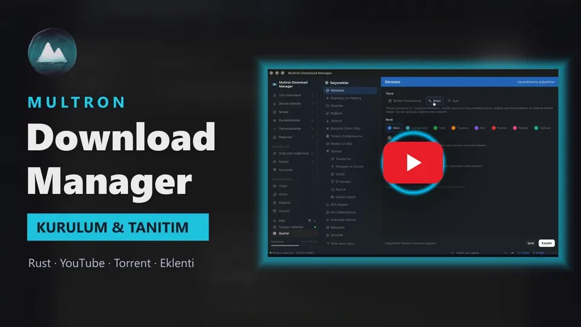
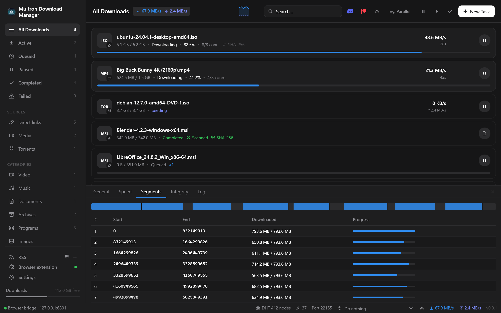
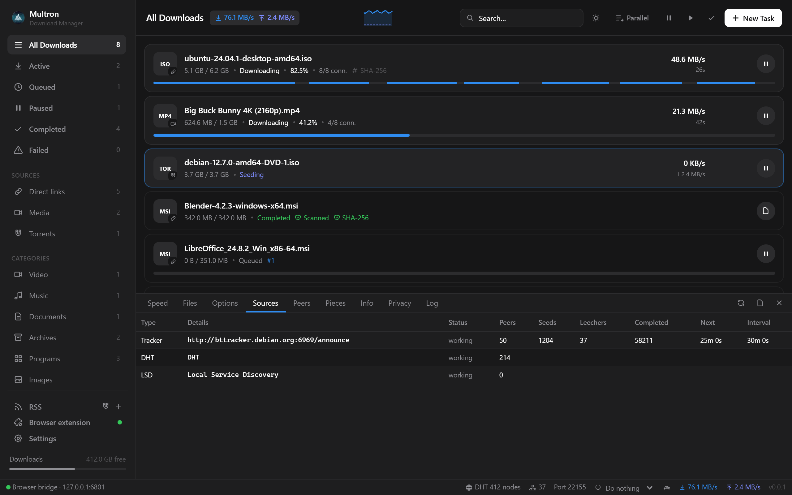
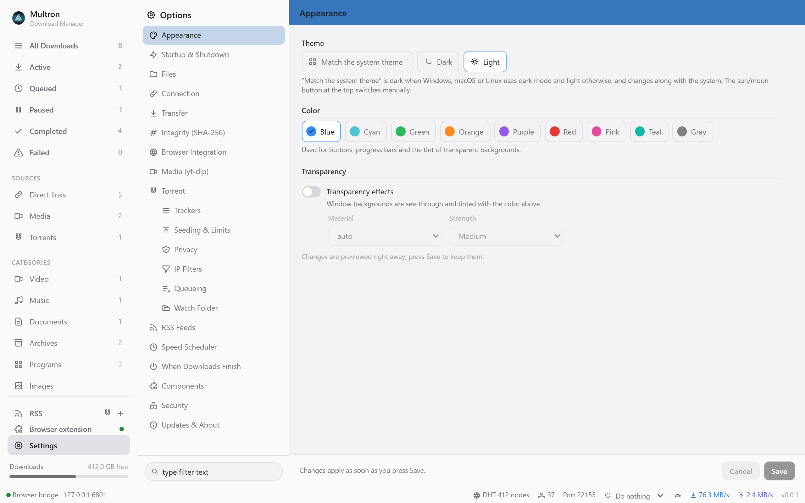
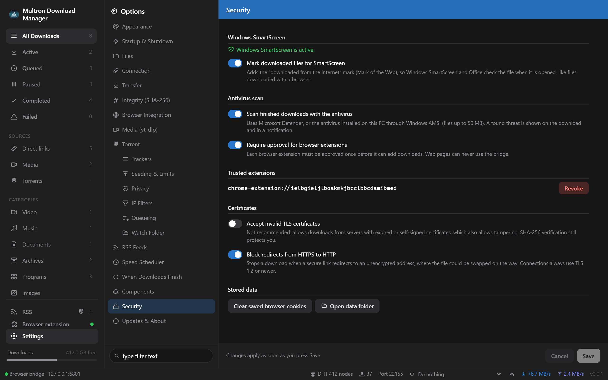
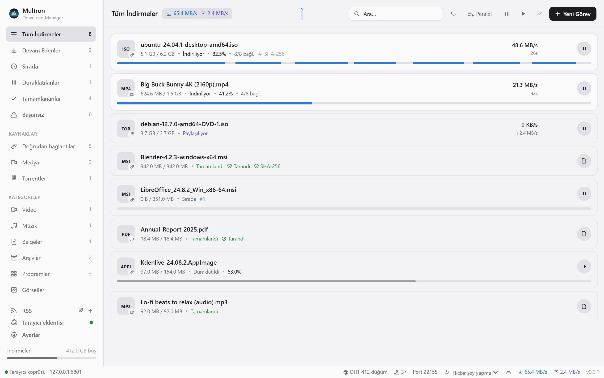

<p align="center">
  
</p>

<h1 align="center">Multron Download Manager</h1>

<p align="center">
  Rust ile yazılmış hızlı, çoklu bağlantılı bir indirme yöneticisi — doğrudan bağlantılar, YouTube / Reddit / Instagram ve 1.800'den fazla diğer siteden videolar, Google Drive ve MEGA dosyaları ile tam özellikli bir BitTorrent istemcisi, hepsi tek bir hafif masaüstü uygulamasında.
</p>

<p align="center">
  
  
  
  
  
  
</p>
<div align="center">

---

[](https://github.com/Multron-Community/Multron-Download-Manager/releases/latest)
[](https://github.com/Multron-Community/Multron-Download-Manager/releases)

[](https://github.com/Multron-Community/Multron-Download-Manager/releases/latest)
[](https://github.com/Multron-Community/Multron-Download-Manager/releases/latest)
[](https://github.com/Multron-Community/Multron-Download-Manager/releases/latest)

---

## Lütfen Bir Dil Seçin
<div align="center">

[](README.md)
[](README.tr.md)

</div>

---

<div align="center">
  <a href="https://www.youtube.com/watch?v=4Bk3NDFmTy4" target="_blank"></a>
  <p><i>Videonun tamamını YouTube'da izlemek için görsele tıklayın.</i></p>
</div>

---

## İçindekiler

- [Ekran Görüntüleri](#ekran-görüntüleri)
- [Özellikler](#özellikler)
- [Kurulum](#kurulum)
- [Tarayıcı eklentisi](#tarayıcı-eklentisi)
- [İndirme motoru nasıl çalışır](#indirme-motoru-nasıl-çalışır)
- [Desteklenen kaynaklar](#desteklenen-kaynaklar)
- [Torrentler](#torrentler)
- [SHA-256 doğrulaması](#sha-256-doğrulaması)
- [Ayarlara genel bakış](#ayarlara-genel-bakış)
- [Kaynaktan derleme](#kaynaktan-derleme)
- [Sürüm yayınlama](#sürüm-yayınlama)
- [Proje yapısı](#proje-yapısı)
- [Çeviri yapma](#çeviri-yapma)
- [Güvenlik ve gizlilik](#güvenlik-ve-gizlilik)
- [Lisans](#lisans)

---

## Ekran Görüntüleri

---
</div>

<p align="center">
  
</p>
---

| | |
|---|---|
|  |  |
| **İndirmeler** — her bağlantı kendi aralığına yazar; ilerleme çubuğu baştan sona dolar ve *Parçalar* sekmesi her bağlantının aralığını canlı olarak gösterir. | **Torrentler** — izleyici (tracker), DHT ve LSD kaynakları, eşler (peers), parçalar (pieces) ve daha fazlasıyla besleme (seeding). |
|  |  |
| **Görünüm** — açık, koyu veya sistem teması, vurgu renkleri ve saydamlık. | **Güvenlik** — SmartScreen işareti, Multron Cloud taraması (test aşamasında), programların güvenli açılması, eklenti onayı, TLS ve yönlendirme kuralları. |
|  | |
| **12 dil seçeneği** — sistem dilini otomatik takip eder (burada Türkçe gösterilmektedir). | |


---

## Özellikler

**Hız**
- **Çoklu bağlantılı indirme** — her dosya paralel bayt aralıklarına bölünür; **varsayılan olarak 8 bağlantı** kullanılır, indirme çalışırken bile genel veya indirme bazında 1'den 64'e kadar ayarlanabilir.
- **Hıza göre iş çalma (Work stealing)** — bir bağlantı kendi aralığını bitirdiğinde, tamamlanması en uzun sürecek aralığın bir kısmını devralır. Bölünme her bağlantının ölçülen hızına göre yapılır: yavaş bir bağlantı yalnızca yaklaşık bir saniyede bitirebileceği kadarını tutar, hızlı olan ise geri kalanını alır. Böylece son bayta kadar tüm bağlantılar meşgul kalır ve yavaş sunucular indirmeyi geciktirmez.
- **Duran bağlantılar yenilenir** — diğerleri indirmeye devam ederken 3 saniye boyunca hiçbir şey almayan bir bağlantı, 30 saniyelik zaman aşımını beklemek yerine kaldığı yerden tekrar açılır.
- **Doğrudan diske yazma** — dosya önceden tahsis edilir (NTFS'de sparse/seyrek olarak oluşturulur, böylece sıfırla doldurma gecikmeleri yaşanmaz; Linux ve macOS'ta `fallocate` / `F_PREALLOCATE` ile gerçek alan ayrılır) ve her bağlantı doğrudan nihai konumuna yazar. Birleştirme adımı yoktur: son bayt diske indiğinde dosya hazırdır.
- **Disk alanı kontrolü** — sürücüye sığmayan bir indirme, sona yakın başarısız olmak yerine net bir mesajla başlamadan önce durur.
- **Güvenli devam etme** — sunucunun ETag / Last-Modified bilgisi saklanır ve her aralık isteğinde `If-Range` ile gönderilir. Dosya sunucuda değiştiyse, Multron Download Manager iki sürümü karıştırmak yerine baştan başlar; her aralık yanıtı ayrıca istenen konum ve toplam boyuta göre kontrol edilir.
- **Aralık başına tek TCP bağlantısı** — indirmeler için HTTP/1.1 zorunlu kılınır, böylece aralıklar tek bir HTTP/2 soketine sıkıştırılmaz.
- Duraklatma, çökme veya yeniden başlatma sonrasında devam edebilme; kademeli bekleme süresiyle otomatik yeniden denemeler; indirme bazlı ve genel hız sınırları (varsayılan olarak sınırsız).
- **Ağ değişikliklerine dayanıklı** — bağlantı koptuğunda (VPN veya GoodbyeDPI açılıp kapatıldığında, Wi-Fi değiştirildiğinde), indirme *Ağ bekleniyor* durumuna geçer, siteye tekrar erişilene kadar bekler ve taze bağlantılarla devam eder (*Yeniden bağlanılıyor*). Parçaları bozuk gelen video akışları FFmpeg hatasıyla başarısız olmak yerine atılır ve tekrar çekilir.

**Kuyruk ve hız kontrolü**
- **Sıralı mod** — araç çubuğundaki **Paralel / Teker teker** butonuna tek bir tıklama, dosyaların yan yana yerine sırayla indirilmesini sağlar.
- **Kuyruğu yeniden sıralama** — kuyruktaki her indirme kendi sırasını gösterir (`#1`, `#2`…); ↑ / ↓ butonları indirmeyi taşır (çift tıklama: en üste / en alta).
- **İndirme başına hız sınırı** — indirme üzerindeki gösterge butonu Sınırsız, 256 KB/s, 512 KB/s, 1, 2, 5 veya 10 MB/s seçenekleri sunar, böylece bant genişliğinizi indirmeler arasında bölebilirsiniz. Sınırlandırılmış bir indirme `≤ 1 MB/s` rozeti gösterir.

**Listeyi yönetme**
- **Yanlışlıkla yinelenen indirme yok** — listede zaten bulunan bir bağlantıyı veya torrenti eklemek, öncelikle tekrar indirilip indirilmeyeceğini soran bir sistem uyarısı açar ve ona gitmek için *Mevcut olanı göster* seçeneği sunar.
- **Birden fazla indirme seçme** — Ctrl+tıklama (macOS'ta ⌘+tıklama) tekil indirmeleri seçer, Shift+tıklama bir aralığı seçer ve Ctrl+A geçerli görünümdeki her şeyi seçer. Listenin üzerindeki çubuk hepsi için *Duraklat*, *Devam Et* ve *Kaldır* seçenekleri sunar; **Delete** seçimi kaldırır ve **Esc** seçimi temizler.
- **Listeyi temizleme** — araç çubuğundaki ✓ butonu *Bitenleri temizle*, *Başarısız olanları temizle* ve *Tümünü temizle…* seçeneklerini açar. Birden fazla indirmeyi kaldırmak bir kez onay ister ve indirilen dosyaları da silebilir.
- **Diskten silme kapsamlıdır** — tamamlanmamış medya indirmeleri yt-dlp'nin geçici parçalarını da (`.part`, fragmentler, ayrı video ve ses akışları) kaybeder ve başka bir programda hala açık olan veya taranan bir dosya birkaç saniye boyunca silinmek üzere yeniden denenir. Hala silinemiyorsa Multron Download Manager hangi dosyanın kaldığını bildirir.

**Her şey tek bir uygulamada**
- Kuyruklama özellikli doğrudan HTTP/HTTPS indirmeleri (eşzamanlı indirme sayısı yapılandırılabilir).
- **yt-dlp** aracılığıyla medya indirmeleri — YouTube (Shorts ve oynatma listeleri dahil), Reddit, Instagram, X/Twitter, TikTok, Facebook, Vimeo, Twitch, SoundCloud ve çok daha fazlası. 4K / 1080p / 720p / … veya yalnızca ses MP3/M4A seçin.
  - YouTube, YouTube kopyalanan oturum çerezlerini reddettiği için ("Sayfanın yeniden yüklenmesi gerekiyor") önce **tarayıcı çerezleriniz olmadan** indirilir. Çerezler yalnızca YouTube oturum açılmasını istediğinde kullanılır (yaş kısıtlamalı, gizli veya yalnızca üyelere özel videolar). Diğer siteler önce çerezleri kullanır ve site bunları reddederse çerezsiz tekrar dener.
  - Sayfada yalnızca "YouTube" yazsa bile gerçek video başlığı hemen gösterilir.
  - **MP4 her yerde çalışır** — MP4 kapsayıcısı ile *En iyi kalite*, her oynatıcının ve Windows Film ve TV'nin gösterebildiği H.264 video ve AAC sesi (YouTube'da genellikle 1080p'ye kadar) seçer. YouTube, 1440p ve 4K'yı yalnızca VP9/AV1 olarak sunar; bunları elde etmek için bu çözünürlükleri açıkça seçin (VP9/AV1 destekli bir oynatıcıya veya MKV'ye ihtiyaç duyarlar).
- **Google Drive** (büyük dosya onayı ve Docs/Sheets/Slides dışa aktarma dahil), **MEGA** (AES-128-CTR ile anında şifresi çözülür), **Dropbox**, **MediaFire**, **Pixeldrain** ve **GitHub** için paylaşım bağlantısı çözücüler.
- Yerleşik **BitTorrent istemcisi** (librqbit): magnet bağlantıları, .torrent dosyaları, dosya seçimi, DHT, uTP, UPnP, LSD, izleyiciler, besleme (seeding) kuralları, IP filtreleri, SOCKS5 vekil sunucusu ve BiglyBT tarzı ayrıntı görünümü (Hız, Dosyalar, Seçenekler, Kaynaklar, Eşler, Parçalar, Bilgi, Gizlilik, Günlük).
- **SHA-256 doğrulaması** — isteğe bağlı olarak her dosyanın beklenen karmasını (hash) sorar ve indirme bittiğinde otomatik olarak doğrular.

**Görünüm**
- **Açık ve koyu temalar** veya **Sistem temasına uy** (Windows, macOS ve Linux'u takip eder ve onlarla birlikte geçiş yapar). Araç çubuğundaki güneş/ay butonu manuel olarak geçiş sağlar.
- **Dokuz vurgu rengi** — Mavi (varsayılan), Camgöbeği, Yeşil, Turuncu, Mor, Kırmızı, Pembe, Camgöbeği Yeşili ve Gri — butonlar, ilerleme çubukları ve saydam arka planların tonu için kullanılır.
- Üç yoğunlukta (Hafif, Orta, Güçlü) **Saydamlık efektleri**: Windows 11'de **Acrylic** veya **Mica**, Windows 10'da Bulanıklık, macOS'ta canlanma (vibrancy). Linux düz arka planları korur; tema ve renkler yine de geçerlidir.

**Güvenlik**
- **SmartScreen / Gatekeeper** — tamamlanan dosyalar "internet üzerinden indirildi" işaretini alır, böylece sistem açıldıklarında bunları kontrol eder ve indirme bir **SmartScreen** (veya **Gatekeeper**) rozeti gösterir; antivirüsünüz bir indirmeyi engellediğinde veya kaldırdığında bir uyarı ile işaretlenir. Bkz. [Güvenlik ve gizlilik](#güvenlik-ve-gizlilik).
- **Multron Cloud ile kötü amaçlı yazılım taraması (test aşamasında)** — tamamlanan her indirme, antivirüsünüzden ayrı olarak bulutta kontrol eden ve kendine ait bir **Multron Cloud** rozeti bulunan bir **Kötü amaçlı yazılım tara** butonuna sahiptir. Tamamlanan programların ve betiklerin otomatik taranması varsayılan olarak açıktır; sözleşme Multron Download Manager başladığında bir kez sorulur ve reddetmek otomatik taramayı kapatır. Hangi dosya türlerini kontrol edeceğini siz seçersiniz (varsayılan olarak programlar ve betikler veya tüm dosyalar).
- **Parola korumalı arşivler** — bir ZIP veya 7z arşivi kilitli olduğunda, Multron Download Manager parolasını sorar, özel bir klasörde açar ve içindeki dosyaları tarar.
- **Tarama sonuçlarını temizleme** — her indirme kendi Multron Cloud sonucunu (örneğin *Multron Cloud: taranmadı*) ve antivirüsünüz durdurduğunda *Antivirüsünüz tarafından engellendi* bilgisini gösterir; bir dosyanın neden taranmadığını veya ne bulunduğunu görmek için bir rozete tıklayın.
- **İndirme ve tarama bildirimleri** — bir indirme başladığında, bittiğinde (*Aç* ve *Klasörde göster* ile) veya başarısız olduğunda, bir indirmenin Multron Cloud taraması bittiğinde ve antivirüsünüz bir indirmeyi engellediğinde, Multron Download Manager'ın kendi kartları ekranın köşesinde, diğer pencerelerin üzerinde ve uygulama arka plandayken veya simge durumundayken açılır. Windows, macOS veya Linux bildirim ayarlarına bağlı değildirler. Her iki tür de *Ayarlar → Başlangıç ve Kapatma* bölümünden kapatılabilir; *Bildirimleri pencere içinde de göster* seçeneği, ön plandayken bunları pencere içinde gösterir.
- **Yanlışlıkla program çalıştırma yok** — indirilen bir programa çift tıklamak veya aç butonuna basmak, bu seçeneği kapatmadığınız sürece, çalıştırmadan önce dosyayı, nereden geldiğini, Multron Cloud sonucunu ve SmartScreen'in kontrol edip etmeyeceğini göstererek ve henüz taranmamış dosyalar için *Önce tara* seçeneğiyle onay ister.

**Masaüstü entegrasyonu**
- Sistem tepsisi (sistem çekmecesi) simgesiyle **arka planda** çalışır; pencereyi kapatmak indirmeleri, beslemeyi (seeding) ve tarayıcı köprüsünü canlı tutar.
- **Tasınabilir (Portable) Windows sürümü** — taşınabilir zip dosyasını herhangi bir yere (USB bellek dahil) çıkarın; ayarlar ve indirme listesi `data` klasöründe kalır ve kendi kendini bulunduğu yerde günceller.
- **Sistemle birlikte başlat** — tepside gizli olarak başlayacak şekilde *Windows ile başlat*, macOS'ta *Oturum açıldığında aç* (Giriş Öğeleri) veya Linux'ta (GNOME, KDE, Xfce…) bir otomatik başlatma girdisi.
- **Görev çubuğunda ilerleme** — dosyalar indirilirken, Windows görev çubuğundaki Multron Download Manager butonu (macOS'taki Dock simgesi) genel ilerleme ile dolar ve sağ alt köşesinde (vurgu renginizde) dönen bir halka alır; tepsi simgesi aynı halkayı alır ve ipucu yüzdeyi ve hızı gösterir. Multron Download Manager arka plandayken bir indirme bittiğinde, başarısız olduğunda veya bir tehdit bulunduğunda görev çubuğu butonu yanıp söner.
- Bildirimler, .torrent dosyalarını sürükleyip bırakma, eklemek için herhangi bir yere bağlantı yapıştırma.
- **Zorunlu güncellemeler** — Multron Download Manager başladığında GitHub Releases'i kontrol eder; yeni bir sürüm varsa indirme ilerlemesiyle birlikte *Multron Download Manager x.y.z sürümüne güncelleniyor* gösterir, sürümün imzalı `update.json` dosyasını ve dosyanın SHA-256 karmasını kontrol eder (bkz. [Güncellemeler nasıl doğrulanır](#güncellemeler-nasıl-doğrulanır)), uygulama kullanılmadan önce kurar ve yeniden başlatır. İnternet bağlantısı olmadığında Multron Download Manager normal şekilde başlar ve bir sonraki sefer tekrar dener; indirme üç kez başarısız olursa devam etmenize izin verir ve bir sonraki başlangıçta tekrar dener. Multron Download Manager çalışırken bulunan sürümler arka planda indirilir ve kapatıldığında kurulur. Geliştirme sürümleri asla kendilerini güncellemez.
- Uygulama içinden uygulama ve yt-dlp için **Sürüm kontrolü** (Ayarlar → Güncellemeler ve Hakkında).
- **Topluluk bağlantıları** — araç çubuğundaki (ayrıca *Ayarlar → Güncellemeler ve Hakkında* içindeki) Discord ve Patreon butonları [Multron Download Manager Discord sunucusunu](https://discord.gg/xXmQw3MUAR) ve [Patreon üzerindeki Multron Download Manager sayfasını](https://www.patreon.com/cw/multron) açar.
- **Dil dosyalarından diller** — varsayılan olarak Windows / macOS / Linux dilini takip eder (çeviri olmadığında İngilizce) — İngilizce, Türkçe, Almanca, Fransızca, İspanyolca, İtalyanca, Portekizce (Brezilya), Rusça, Japonca, Çince (Basitleştirilmiş), Çince (Geleneksel) ve Korece; bir dil elle de seçilebilir. Çeviriler `frontend/src/lang/<code>.json` içinde yer alır (bkz. [Çeviri yapma](#çeviri-yapma)).

---

## Kurulum

Sisteminiz için uygun dosyayı [en son sürümden](https://github.com/Multron-Community/Multron-Download-Manager/releases/latest) indirin. Her sürüm tüm platformları içerir:

| Platform | Dosya | Kurulum |
| --- | --- | --- |
| Windows 10/11 x64 | `Multron-Download-Manager-<sürüm>-x64-Setup.exe` | Kurulum programını (Inno Setup) çalıştırın. Eksikse WebView2'yi kurar ve `.torrent` dosyaları ile `magnet:` bağlantılarını ilişkilendirebilir. |
| Windows 10/11 x64, taşınabilir | `Multron-Download-Manager-<sürüm>-x64-portable.zip` | İstediğiniz yere (USB bellek dahil) çıkarın ve `multron-download-manager.exe` dosyasını çalıştırın. Ayarlar ve indirme listesi yanındaki `data` klasöründe kalır ve yerinde güncellenir. Windows 10/11'de normalde zaten bulunan WebView2'ye ihtiyaç duyar. |
| macOS Apple Silicon | `*_aarch64.dmg` | DMG dosyasını açın ve uygulamayı Uygulamalar (Applications) klasörüne sürükleyin. |
| macOS Intel | `*_x64.dmg` | Yukarıdaki ile aynı. |
| Ubuntu 24.04+ / Mint 22+ / Debian 13+ (apt) | `*_amd64.deb` (veya `*_arm64.deb`) | `sudo apt install ./<dosya>.deb` |
| Debian 12 bookworm / LMDE 6 (apt) | `*_debian12_amd64.deb` (veya `*_debian12_arm64.deb`) | `sudo apt install ./<dosya>.deb` |
| Fedora 43+ (dnf) | `*_fedora_x86_64.rpm` (veya `*_fedora_aarch64.rpm`) | `sudo dnf install ./<dosya>.rpm` |
| openSUSE Leap 16 / Tumbleweed (zypper) | `*_opensuse_x86_64.rpm` (veya `*_opensuse_aarch64.rpm`) | `sudo zypper install --allow-unsigned-rpm ./<dosya>.rpm` |
| Herhangi bir Linux | `*_amd64.AppImage` (veya `*_aarch64.AppImage`) | `chmod +x <dosya>.AppImage && ./<dosya>.AppImage` |
| Tarayıcı eklentisi | `multron-browser-extension-chromium-v<sürüm>.zip` (Chrome, Edge, Brave, Opera, Vivaldi) veya `multron-browser-extension-firefox-v<sürüm>.zip` | Bkz. [Tarayıcı eklentisi](#tarayıcı-eklentisi). |

Her sürüm, her dosyanın SHA-256 karmasını listeleyen imzalı bir `update.json` dosyasına sahiptir. Bu depodan `node scripts/verify-update.mjs update.json update.json.sig <dosya>` komutuyla bir indirmeyi kontrol edin veya `gh attestation verify <dosya> --repo Multron-Community/Multron-Download-Manager` komutuyla nerede derlendiğini doğrulayın (bkz. [Güncellemeler nasıl doğrulanır](#güncellemeler-nasıl-doğrulanır)).

> **Linux:** her paket amaçlandığı dağıtım üzerinde derlenir. Düz `.deb` ve AppImage, Ubuntu 24.04 üzerinde derlenir ve glibc 2.39 veya daha yenisine ihtiyaç duyar (Ubuntu 24.04+, Linux Mint 22+, Debian 13+). Debian 12 (bookworm) ve LMDE 6, Debian 12 üzerinde derlenen kendi `.deb` paketine sahiptir; Fedora, Fedora 43 üzerinde derlenen kendi `.rpm` paketine sahiptir ve openSUSE, Leap 16 üzerinde derlenen kendi `.rpm` paketine sahiptir (Tumbleweed üzerinde de çalışır). Otomatik güncellemeler her kurulumu kendi dağıtımı için derlenen pakette tutar. Ubuntu 22.04 veya Linux Mint 21 gibi eski sürümler desteklenmez.

> **macOS:** derlemeler henüz noter onayından (notarization) geçmemiştir. İlk seferinde uygulamaya sağ tıklayın → **Aç** seçeneğini kullanın veya `xattr -cr "/Applications/Multron Download Manager.app"` komutunu çalıştırın.

**Harici araçlar** — elle hiçbir şeyin kurulması gerekmez:
- **yt-dlp**, ilk kullanımda uygulamanın veri klasörüne en son GitHub sürümünden indirilir (Python gerekmez).
- **Her zaman güncel** — Multron Download Manager başladığında ve her 6 saatte bir yt-dlp'yi ve kurduğu FFmpeg'i kontrol eder ve video indirilmiyorken bunları günceller (aksi takdirde 30 dakika sonra tekrar dener). Yeni FFmpeg eskisinin yanına çıkarılır ve yalnızca tamamlandığında değiştirilir. Windows ve Linux'ta FFmpeg en fazla haftada bir kez yenilenir, çünkü derlemeleri günlük olarak değişir; macOS'ta yeni bir sürüm çıktığında yenilenir. Sistem paket yöneticisinden gelen bir FFmpeg paket yöneticisine bırakılır.
- **FFmpeg** (çoğu site, YouTube dahil, video ve sesi ayrı akışlar olarak sunduğundan ve MP3 dönüştürme için gereklidir) Windows, macOS ve Linux'ta (x86_64 ve arm64, ayrıca AppImage'dan) ilk medya indirmesinde veya *Ayarlar → Medya* bölümünden otomatik olarak kurulur. Sistemde zaten kurulu olan bir FFmpeg varsa o kullanılır.
- **12K'ya kadar her kalite** — *En İyi*, bir videonun sahip olduğu en yüksek çözünürlüğü (4K, 8K, 12K) alır; ayrıca uygulama içinde ve tarayıcı eklentisinde 12K, 8K, 5K, 4K, 1440p, 1080p, 720p, 480p, 360p, 240p, 144p veya yalnızca ses (MP3, M4A, AAC, Opus, OGG Vorbis, FLAC, WAV, ALAC) seçebilirsiniz. Her kalite indirmeden önce boyutunu gösterir. Videolar MP4, MP4 (H.264, her yerde çalışır — WhatsApp, telefonlar ve TV'ler için), MKV, WebM, MOV, AVI veya FLV olarak kaydedilebilir, yeni indirme penceresinde veya eklenti menüsünde indirme başına seçilebilir.
- **Çoklu bağlantılı video indirmeleri** — yt-dlp videoyu bulur ve tek bir dosya olarak sunulan bir video, çoklu bağlantı motoruyla indirilir (indirmenin *Bağlantılar* ayarı kullanılarak), ardından resim ve sesi birleştiren, meta verileri ve küçük resmi ekleyen yt-dlp'ye geri teslim edilir. YouTube videoları da YouTube'un yavaşlatmaması için en fazla 8 MB'lık isteklerle motor üzerinden geçer. Parçalar halinde sunulan videolar (HLS / DASH), *Bağlantılar* ayarının izin verdiği kadar çok parça aynı anda çekilecek şekilde (64'e kadar) alınır. Bir video indirilirken bağlantıları değiştirmek, ilerlemeyi kaybetmeden iki saniye içinde uygulanır. Doğrudan yöntem bir video için çalışmazsa, yt-dlp videoyu kendi başına indirir.
- **Deno** (yt-dlp'nin YouTube'un hız kontrolünü yanıtlamak için ihtiyaç duyduğu JavaScript çalışma zamanı; o olmadan YouTube indirmeleri yaklaşık 100 KB/s'ye yavaşlatır) Windows (x86_64), macOS ve Linux (x86_64 ve ARM64) üzerinde bir YouTube videosunu ilk indirdiğinizde otomatik olarak kurulur. Sisteminizde zaten var olan bir Deno kullanılır. yt-dlp ve FFmpeg ile güncel tutulur.
- Dosyalarınızla aynı çoklu bağlantı motoruyla indirilirler. FFmpeg kurulurken indirme kendi durumunu gösterir (`FFmpeg: 61 MB / 142 MB · FFmpeg Kuruluyor · %43`, ardından *FFmpeg Çıkarılıyor*); duraklatma veya kaldırma kurulumu durdurur. Kurulum başarısız olursa bir uyarı nedenini belirtir ve video daha düşük bir kalitede kaydedilir.

---

## Tarayıcı eklentisi

Eklenti (Chromium tabanlı tüm tarayıcılar — Chrome, Edge, Brave, Opera, Vivaldi, Arc, Dia… — ve Firefox ile türevleri) indirmeleri uygulamaya gönderir:

- **Her tarayıcı indirmesini devralır** — dosya bağlantılarına tıklamalar doğrudan Multron Download Manager'a gider, böylece tarayıcı bunları asla başlatmaz; başka bir şekilde başlatılan indirmeler (betikler, yönlendirmeler, formlar) göründükleri anda duraklatılır, Multron Download Manager'a teslim edilir ve tarayıcıdan kaldırılır. Gerçek dosya URL'si, yönlendiren (referrer) ve çerezler aktarılır, böylece oturum açılmış indirmeler çalışır.
- **Kapatıldığında Multron Download Manager'ı başlatır** — uygulama çalışmıyorsa eklenti yerel mesajlaşma (native messaging) aracılığıyla tepside başlatır (Chrome, Edge, Brave, Vivaldi, Chromium ve Firefox; Multron Download Manager ilk çalıştığında kendini kaydeder) ve ardından indirmeyi teslim eder. Yalnızca uygulama başlatılamazsa tarayıcı dosyayı kendisi indirir.
- **Her buton bir isim gösterir** — bir oynatıcıdaki *İndir* butonu ile dosya ve müzik sayfalarındaki Multron Download Manager butonu her sitede neyin indirileceğini söyler (`İndir: <başlık>`). İsim sitenin kendisinden (YouTube, Shorts, Reddit, X, TikTok…), temizlenmiş sekme başlığından, sayfanın `og:title` bilgisinden, bağlantıdaki dosya adından veya sitenin resmi oEmbed başlığından (YouTube, Vimeo, TikTok, SoundCloud, Dailymotion, Reddit, X) gelir; bunların hepsi boşsa site adına geri döner, böylece buton asla boş kalmaz. Aynı isim indirme ile birlikte Multron Download Manager'a gönderilir ve sayfayı yeniden yüklemeden videoları değiştirdiğinizde YouTube'u takip eder.
- Kalite menüsü ile herhangi bir sitede **videonun üzerinde "Video indir" butonu**. Akışlarda (Reddit, Instagram, X, YouTube, TikTok, Facebook) her video kendi gönderisine çözümlenir. Reddit videoları oynatıcının HLS akışından alınır, oturum açmadan çalışır ve gönderi başlığına göre adlandırılır. Butonu sayfada istediğiniz yere sürükleyin (konumu site başına hatırlanır; çift tıklama geri koyar) ve kalite menüsü her kalitenin boyutunu gösterir.
- **Bu sayfadaki tümünü indir** (açılır pencere veya bağlam menüsü) — sayfadaki her videoyu, görseli, ses dosyasını, dosya bağlantısını, magnet bağlantısını ve gönderiyi toplar. Sizin için sonsuz akışları kaydırabilir (5 / 20 / 60 ekran) ve site eski gönderileri kaldırırken gördüklerini tutar. Reddit galerileri orijinal boyutundaki görseller olarak gelir, X görselleri `name=orig` olarak gelir ve reklamlar ile tanıtılan gönderiler atlanır. Reddit'te ayrıca insanların **yorumlar içinde** paylaştıklarını da toplar: oynatıcılar, videolar, GIF'ler, görseller ve video bağlantıları (v.redd.it, YouTube, Streamable, Imgur, RedGIFs, X, Instagram, TikTok…), her biri gönderi ve yorum yapanın adıyla adlandırılır. `v.redd.it` bağlantıları akışlarından indirilir, böylece oturum açmadan çalışırlar. Multron Download Manager ardından bir seçici açar:
  - sayılar içeren tür filtreleri (videolar, görseller, sesler, dosyalar, gönderiler) ve bir isim/adres araması;
  - tümünü seç, hiçbirini seçme veya tersine çevir ve zaten Multron Download Manager'da bulunan öğeleri gizle;
  - her medya öğesi için tek bir video kalitesi;
  - sayfanın adını taşıyan bir klasöre kaydet ve isteğe bağlı olarak her şeyi duraklatılmış olarak ekle.
- **Tam ekran videolarda küçük indirme simgesi** — geniş buton yerine, sol üst köşede oynatıcının kontrolleriyle birlikte kaybolan yuvarlak bir simge. Üzerine gelindiğinde gösterilen × simgesi o sayfada gizler; *Ayarlar → Tarayıcı Entegrasyonu → Tam ekran videolarda indirme simgesini göster* seçeneği her yerde kapatır.
- **Dosya barındırma sayfalarında "Multron Download Manager" butonu** (Google Drive, MEGA, MediaFire, Dropbox, Pixeldrain).
- **Uygulamadan yönetin** — *Ayarlar → Tarayıcı Entegrasyonu* kurulu tarayıcılarınızı (her biri bir *Eklenti kur* butonu ile) ve bağlı her eklentiyi gösterir. *Yeniden Kur* kurulum asistanını açar; *Tarayıcıdan kaldır* eklentinin kendini kaldırmasını sağlar (tarayıcı açıkken yarım dakika içinde); *Tamamen kaldır* her tarayıcıdan kaldırır, tüm bağlantıları unutur ve tekrar bir eklenti bağlayana kadar kapalı kalan Multron Download Manager'ın yerel mesajlaşma kaydını siler.
- **Uygulama ile birlikte güncellenir** — tarayıcılar paketlenmemiş veya geçici bir eklentiyi dosyaları değiştiğinde yeniden yüklemez, bu nedenle eklenti her bağlandığında uygulamanın sürümünü kontrol eder ve uygulama daha yeniyse (sürüm başına bir kez) güncellenen klasörden kendini yeniden yükler. AppImage ve Flatpak tarayıcıları, Multron Download Manager her başladığında yenilenen eklentinin bir kopyasını kullanır.
- Multron'da **magnet bağlantılarını** açar.
- Bağlam menüsü: *Bağlantıyı indir*, *Bağlantıdan video/ses indir*, *Bu medyayı indir*, *Bu sayfadaki videoyu indir*, *Bu sayfadaki tümünü indir*, *Seçilen bağlantıyı indir*.
- Açılır pencere (Popup): bağlantı durumu, mevcut sayfa için hızlı kalite seçici, kaydırma derinliği ile *Tümünü indir…*, bağlantı yapıştırma kutusu ve seçenekler (minimum dosya boyutu, atlanacak alan adları, port).

**Kurulum — kurulum asistanı çoğunu halleder**

Yan çubukta **Tarayıcı eklentisi** seçeneğine tıklayın (ilk başlangıçta da açılır):

1. Tarayıcınızı seçin — Multron Download Manager kurulu olanları listeler: Chrome (Beta, Dev, Canary dahil), Edge (Beta, Dev, Canary dahil), Brave, Opera, Opera GX, Vivaldi, Chromium / Ungoogled Chromium, Arc, Dia, Yandex, Naver Whale, Thorium, Supermium, Cent, Comodo Dragon, Epic, Avast / AVG / CCleaner Secure Browser, Sidekick, Wavebox, Firefox (Developer Edition ve Nightly dahil), LibreWolf, Waterfox, Floorp, Zen ve Mullvad Browser. Windows'ta ayrıca sisteme kayıtlı diğer tarayıcıları (Ayarlar → Varsayılan uygulamalar) nerede kurulu olurlarsa olsunlar bulur ve Chromium tabanlı olanları Firefox tabanlı olanlardan dosyalarına göre ayırır.
2. **Hazırla ve aç** butonuna basın. Multron Download Manager kendisiyle birlikte kurulan eklenti klasörünü kullanır (güncellemeler boyunca aynı yol, her güncellemede yenilenir), tarayıcının eklentiler sayfasını açar ve klasör yolunu panoya kopyalar.
3. Tarayıcıda:
   - **Chromium tarayıcılar:** **Geliştirici modunu** açın, **Paketlenmemiş öge yükle** butonuna tıklayın, yolu yapıştırın (`Ctrl+V` veya macOS'ta `⌘+Shift+G` ardından `⌘+V`) ve onaylayın — veya klasörü sayfanın üzerine sürükleyin.
   - **Firefox:** **Geçici Eklenti Yükle…** butonuna tıklayın ve `manifest.json` dosyasının yolunu yapıştırın. Firefox kapandığında geçici eklentileri kaldırır; yeniden başlatmanın ardından asistanı tekrar çalıştırın.
4. Eklenti kendiliğinden bağlanır — Multron'da **İzin ver** butonuna basın. Asistan bağlandığında gösterir.

**Linux üzerinde Flatpak tarayıcıları** (Flathub: Chrome, Chromium, Ungoogled Chromium, Edge, Brave, Opera, Vivaldi, Yandex, Firefox, LibreWolf, Waterfox, Floorp ve Zen) da bulunur ve *(Flatpak)* olarak listelenir. Asistan bunları `flatpak run` ile açar ve eklentiyi korumalı alandaki (sandbox) tarayıcının her zaman okuyabileceği kendi klasörüne (`~/.var/app/<uygulama kimliği>/`) kopyalar. İndirmeler hemen çalışır, çünkü eklenti uygulamaya `127.0.0.1` üzerinden ulaşır. Eklentinin kapalıyken Multron Download Manager'ı da başlatmasına izin vermek için tarayıcının korumalı alanının dışındaki programları başlatma iznine ihtiyacı vardır; asistan komutu gösterir, örneğin `flatpak override --user --talk-name=org.freedesktop.Flatpak org.mozilla.firefox` ve tarayıcının korumalı alanını esnettiği için bunu bir kez kendiniz çalıştırırsınız.

Tarayıcılar diğer programların paketlenmemiş eklentileri sessizce kurmasına izin vermez, bu nedenle tarayıcının kendi *Paketlenmemiş öge yükle* adımı elle kalır. Her sürümden gelen eklenti zip dosyası (`multron-browser-extension-chromium-v<sürüm>.zip` / `-firefox-`) aynı şekilde çalışır.

Eklenti, uygulama ile yalnızca `[http://127.0.0.1:6801](http://127.0.0.1:6801)` üzerinden konuşur (port her iki tarafta da yapılandırılabilir).

---

## İndirme motoru nasıl çalışır

```text
            test et (Range: bytes=0-0) ──► boyut, aralık desteği, dosya adı
                          │
            file.part alanını ayır (sparse) ── N aralığa böl (varsayılan 8)
                          │
    ┌────────────┬────────┴──┬────────────┐
  bağlantı 1   bağlantı 2  …  bağlantı 7  bağlantı 8    her biri: GET Range: bytes=a-b
    │            │           │            │           1 MiB arabellek → konumsal yazma
    └── boşta kalan bağlantı en yavaş aralığı devralır, hıza göre bölünür ──┘
                          │
              tüm aralıklar tamamlandı → file.part yeniden adlandır → file
                          │
              isteğe bağlı SHA-256 doğrulaması
```

- Aralıklar konumsal G/Ç (`pwrite` / `seek_write`) ile yazılır, böylece bağlantılar asla bir dosya imleci için yarışmaz.
- İlerleme birkaç saniyede bir kalıcı hale getirilir; yalnızca diske ulaşan baytlar kaydedilir, böylece bir çökmeden sonra devam etmek güvenlidir.
- Bağlantı sayısı değişiklikleri canlı olarak uygulanır: ek işçiler indirmeyi yeniden başlatmadan oluşturulur veya emekliye ayrılır.
- Aralık desteği olmayan sunucular otomatik olarak tek bir akışa geri döner.

Motorun gerçek ağ kendi kendini test etme özelliğini çalıştırın (aynı dosyayı 8 ve 1 bağlantı ile indirir, SHA-256'yı karşılaştırır ve her iki hızı da yazdırır):

```bash
cargo test --release --manifest-path src-tauri/Cargo.toml engine_network -- --ignored --nocapture
```

---

## Desteklenen kaynaklar

| Kaynak | Nasıl |
| --- | --- |
| Herhangi bir `http(s)` dosyası | Çoklu bağlantı motoru |
| Video/ses içeren web sayfaları (YouTube, Reddit, Instagram, X, TikTok, Facebook, Vimeo, Twitch, SoundCloud, Dailymotion, Bilibili, …) | Canlı ilerleme, oynatma listeleri, kalite hazır ayarları, eklentiden veya tarayıcıdan gelen çerezler ile yt-dlp |
| Google Drive dosyaları ve Docs/Sheets/Slides | Doğrudan indirmeye dönüştürülür (büyük dosya uyarısı işlenir) |
| MEGA dosya bağlantıları (`mega.nz/file/…#key`) | Çoklu bağlantı motoru ile indirilir ve anında şifresi çözülür |
| Dropbox, MediaFire, Pixeldrain, GitHub blob bağlantıları | Doğrudan indirme URL'lerine dönüştürülür |
| Magnet bağlantıları ve `.torrent` dosyaları/URL'leri | Yerleşik BitTorrent istemcisi |
| Tarayıcınızın indirebileceği diğer her şey | Eklenti, nihai URL + çerezleri uygulamaya teslim eder |

---

## Torrentler

- Magnet bağlantıları, `.torrent` URL'leri veya dosyaları ekleyin (sürükle ve bırak, dosya ilişkilendirmesi veya eklenti).
- Başlamadan önce hangi dosyaların indirileceğini seçin ve seçimi daha sonra değiştirin.
- **Ayrıntı sekmeleri:** Hız grafiği, Dosyalar (dosya başına ilerleme ve seçim), Seçenekler, **Kaynaklar** (durum, seed, leech, tamamlanan, bir sonraki scrape ve aralık ile her izleyici, artı DHT / LSD / gelen satırlar), **Eşler** (adres, istemci, bağlantı türü, indirilen/yüklenen), **Parçalar** haritası, Bilgi (karma, parça boyutu, yorum, oluşturan, magnet bağlantısı), Gizlilik, Günlük.
- Bağlantı: dinleme portu (varsayılan **22155**, TCP + UDP), uTP, UPnP, DHT, Yerel Hizmet Keşfi (LSD), eş sınırı (torrent başına varsayılan **500**). Yanıt vermeyen eşlerden 5 saniye sonra vazgeçilir, böylece motor çalışan eşlere hızlıca geçer. Sessizleşen bağlı eşler (örneğin şu anda size göndermeyen bir seed) 150 saniye boyunca bağlı kalır ve her dakika bir canlı tutma (keep-alive) alır, böylece yeni bir bağlantı olmadan tekrar göndermeye başlayabilirler. Disk yazmaları ve parça kontrolleri 32 adede kadar iş parçacığında (CPU çekirdeklerinin iki katı) çalışır, böylece birçok eşe sahip hızlı bağlantılar disk tarafından tutulmaz.
- İzleyiciler (Trackers): tüm torrentler veya torrent başına ek izleyiciler, tek tıkla açık izleyici listesi, izleyici tarama (scraping).
- **Otomatik eklenen açık izleyiciler (varsayılan olarak açık):** özel (private) olmayan torrentler ve magnet bağlantıları tanınmış açık izleyici listesine de ([ngosang/trackerslist](https://github.com/ngosang/trackerslist), günde bir kez yenilenir ve çevrimdışı kullanım için saklanır) duyuru yapar, böylece daha fazla eş bulurlar ve daha hızlı başlarlar. Özel torrentler asla değiştirilmez.
- Besleme (Seeding): tamamlandıktan sonra beslemeye devam etme, bir paylaşım oranında ve/veya belirli bir dakika sonra durma, ardından duraklatma, kaldırma veya dosyalarla birlikte kaldırma; genel indirme/yükleme sınırları.
- **Kuyruklama:** maksimum aktif indirme ve besleme torrenti; geri kalanlar bekler ve sırayla başlar (oklarla yeniden sıralayın).
- **İndirirken oynat:** bir torrentteki video ve ses dosyaları doğrudan oynatıcınızda açılır, sarma desteğiyle sırayla akış yapılır (yerel, belirteç korumalı adres).
- Bir dosyadan veya klasörden **torrent oluşturma** (izleyiciler, parça boyutu), `.torrent` dosyasını kaydetme ve hemen beslemeye başlama.
- **Yeniden kontrolü zorla** indirilen verileri tekrar doğrular; **.torrent dışa aktar** herhangi bir indirmenin torrent dosyasını kaydeder.
- **İzleme klasörü:** bir klasöre kaydedilen `.torrent` dosyaları otomatik olarak eklenir.
- **RSS:** RSS/Atom akışlarını takip edin (magnet ve .torrent ögeleri, Torznab boyutu ve magnet nitelikleri), ögelerine RSS görünümünde göz atın ve kurallarla (içerilecek/hariç tutulacak kelimeler veya regex, akış başına, kendi kaydetme klasörü, duraklatılmış başlama) yenilerini otomatik indirin.
- **Hız zamanlayıcısı:** tüm indirmeler ve torrentler için elle veya seçilen saatler ve günler için otomatik olarak açılan alternatif hız sınırları (durum çubuğundaki "kaplombağa" butonu).
- **İndirmeler bittiğinde:** tamamlanan her indirme için bir program çalıştırın (`{file}`, `{dir}`, `{name}`, `{url}`) ve her şey bittiğinde uykuya geçin, kapatın veya Multron'dan çıkın.
- Multron Download Manager'ın kullandığı torrent motorunda (librqbit) bulunmayanlar: protokol şifreleme, dosya bazlı öncelikler, tamamlanan verileri taşıma ve süper besleme (super-seeding).
- **Gizlilik:** tüm eş bağlantıları için SOCKS5 vekil sunucusu, arabirim bağlama, IP filtreleri ve DHT / LSD / izleyicileri devre dışı bırakma.
- **IP filtreleri:** engelleme listesi veya izin listesi modu, bir dosyadan veya URL'den otomatik yükleme (eMule DAT, PeerGuardian P2P, CIDR; düz metin, gzip veya zip), ayrı IPv6 listesi, elle aralıklar, otomatik yenileme periyodu, *Şimdi Yükle*.

---

## SHA-256 doğrulaması

*Ayarlar → Bütünlük → Her indirmeden önce bir SHA-256 iste* seçeneğini etkinleştirin:

- Yeni Görev penceresi her dosya için beklenen SHA-256 karmasını sorar (tarayıcıdan gönderilen indirmeler de pencereyi açar).
- Multron Download Manager ayrıca indirmenin yanında `<dosya>.sha256`, `<dosya>.sha256sum`, `SHA256SUMS` ve `checksums.txt` dosyalarını arar ve karmayı otomatik olarak doldurur.
- İndirme bittiğinde dosya karması alınır ve karşılaştırılır. Bir uyuşmazlık indirmeyi her iki karma gösterilerek **başarısız** olarak işaretler; bir eşleşme yeşil bir **SHA-256** rozeti gösterir.
- Ayrıca daha sonra indirmenin **Bütünlük** sekmesinden beklenen karmayı ekleyebilir veya değiştirebilir ve yeniden doğrulayabilirsiniz.

---

## Ayarlara genel bakış

Seçenekler penceresi, sol tarafta aranabilir bir ağaç yapısıyla klasik bir torrent istemcisi gibi düzenlenmiştir:

| Bölüm | Ayarlayabileceğleriniz |
| --- | --- |
| Görünüm | Tema (sistem / koyu / açık), vurgu rengi, saydamlık efektleri, malzeme ve yoğunluk — canlı önizlemeli |
| Başlangıç ve Kapatma | Dil, sistemle birlikte başlat (ifadeler Windows / macOS / Linux'u takip eder), simge durumunda başlat, tepside çalışmaya devam et, başlangıçta devam et, güncelleme kontrolü, bildirimler |
| Dosyalar | Varsayılan klasör, kategori klasörlerine ayır |
| Bağlantı | İndirme başına bağlantı (varsayılan 8, 64'e kadar), sıralı indirme, eşzamanlı indirmeler, yeniden denemeler, User-Agent |
| Aktarım | Genel hız sınırı |
| Bütünlük | SHA-256 iste, denetim toprağı (checksum) dosyalarını otomatik algıla |
| Tarayıcı Entegrasyonu | Köprü açık/kapalı, port, tarayıcı indirmelerini onayla, tam ekran videolarda indirme simgesi, kurulum asistanı, bağlı eklentiler |
| Medya (yt-dlp) | yt-dlp sürümü ve güncellemesi, FFmpeg kurulumu, Deno kurulumu, varsayılan kalite, varsayılan video biçimi (MP4, MKV, WebM, MOV, AVI, FLV), tarayıcıdan çerezler, meta veri/küçük resim gömme |
| Torrent | Dinleme portu, UPnP, uTP, DHT, LSD, eş sınırı (varsayılan 500) |
| İzleyiciler · Besleme ve Sınırlar · Gizlilik · IP Filtreleri | Bkz. [Torrentler](#torrentler) |
| Bileşenler | Torrent motorunu, medya motorunu, köprüyü, tarayıcıyı (scraper), UPnP, uTP, DHT, LSD ve IP filtresini açın veya kapatın |
| Güvenlik | SmartScreen / Gatekeeper işareti, Multron Cloud taraması (test aşamasında): Kötü amaçlı yazılım tara butonu ve yükleme sınırı, dosya türleri ve yükleme sınırı ile otomatik tarama, sıkıştırılmış yüklemeler, hatırlanan parmak izleri ve bağlantı sayısı; indirilen programları çalıştırmadan önce sorma, eklenti onayı ve güvenilir eklentiler, TLS sertifika ilkesi, HTTPS → HTTP yönlendirme engelleme, saklanan çerezleri temizleme |
| Güncellemeler ve Hakkında | Zorunlu güncellemelerin nasıl çalıştığı, *İndir ve kur*, uygulama ve yt-dlp sürüm kontrolü |

---

## Kaynaktan derleme

### Önkoşullar

| Araç | Notlar |
| --- | --- |
| [Rust](https://rustup.rs) (kararlı, 1.85+) | `rustup default stable` |
| [Node.js](https://nodejs.org) 20+ ve npm | |
| **Windows:** “C++ ile masaüstü geliştirme” içeren Visual Studio Build Tools, WebView2 (Windows 11'de önceden kuruludur) | |
| **Windows kurulum oluşturucu:** [Inno Setup 6](https://jrsoftware.org/isinfo.php) | `winget install -e --id JRSoftware.InnoSetup` |
| **macOS:** Xcode Command Line Tools | `xcode-select --install` |
| **Ubuntu 24.04 / Linux Mint 22 / Debian 13:** | `sudo apt install libwebkit2gtk-4.1-dev libayatana-appindicator3-dev librsvg2-dev patchelf libssl-dev build-essential file libfuse2t64` |
| **Fedora:** | `sudo dnf install webkit2gtk4.1-devel libappindicator-gtk3-devel librsvg2-devel openssl-devel patchelf` ve “C Development Tools and Libraries” grubu |

### Geliştirme modunda çalıştırma

```bash
git clone https://github.com/Multron-Community/Multron-Download-Manager.git
cd Multron-Download-Manager
npm run setup      # Tauri CLI ve ön uç paketlerini kurar
npm run dev        # Sıcak yeniden yükleme (hot reload) ile Vite + Rust uygulamasını başlatır
```

Aynı bilgisayarda çalışan bir tarama sunucusuna karşı Multron Cloud taramasını denemek için, uygulamayı başlatmadan önce `MULTRON_CLOUD_SERVER` değişkenini ayarlayın (örneğin `ws://127.0.0.1:5306/ws`). Yalnızca bu bilgisayardaki adresler kabul edilir; başka herhangi bir şey `wss://[api.viruskov.com/ws](https://api.viruskov.com/ws)` adresini kullanır.

### Kurulum dosyalarını derleme

| Komut | Çıktı (`src-tauri/target/release/bundle/` veya `dist/` içinde) |
| --- | --- |
| `npm run build:windows` | Windows Inno Setup kurulum dosyası ve `dist/` içinde taşınabilir zip (`-x64-portable.zip`) |
| `npm run build:mac` | `.app` ve `.dmg` |
| `npm run build:linux` | `.deb` (apt), `.rpm` (dnf, zypper) ve `.AppImage` |
| `npm run package:extension` | `dist/multron-browser-extension-chromium-v<sürüm>.zip` ve `-firefox-` (Firefox `background.scripts` içeren kendi bildirim dosyasını alır) |

Derlemeler her platformda hız için ayarlanmıştır:

- **Release derlemeleri** her CPU çekirdeğini kullanır (`codegen-units = 16`, thin LTO). Windows çok iş parçacıklı `rust-lld` ile bağlanır (`src-tauri/.cargo/config.toml`); Linux x86_64, Rust 1.90+ ile varsayılan olarak `rust-lld` kullanır ve Linux arm64 release işi `lld` kullanır; macOS, Apple'ın hızlı bağlayıcısını kullanır. Bir kod değişikliğinden sonraki release derlemesi modern bir masaüstü işlemcisinde yaklaşık bir dakika sürer.
- **Dev ve test derlemeleri** bağımlılıklar için hata ayıklama bilgilerini atlar ve yalnızca Multron Download Manager'ın kendisi için satır tablolarını tutar, böylece `cargo test` birkaç saniye içinde yeniden derlenir ve `target` klasörü çok daha küçük kalır.
- **CI** Rust derlemelerini önbelleğe alır (başarısız bir çalıştırmadan sonra da), aynı daldaki eski çalıştırmaları iptal eder ve yalnızca Windows çalıştırıcısında zaten yoksa Inno Setup kurar.

Diğer yararlı komutlar: `npm test` (Rust birim testleri), `npm run check` (clippy + svelte-check), `npm run icons` (`src-tauri/icons/app-icon.png` dosyasından simgeleri yeniden üretme).

---

## Sürüm yayınlama

Sürüm numaraları her bir parçayı 10'a kadar sayar ve bundan sonraki sürüm devreder:

```text
0.0.1 → 0.0.2 → … → 0.0.10 → 0.1.0 → … → 0.1.10 → 0.2.0 → … → 0.10.10 → 1.0.0 → 1.0.1 …
```

1. Değişikliklerinizi commit edin. Sürüm notlarını `release-notes/v<sürüm>.md` içinde yazın (isteğe bağlı) — iş akışı bunları GitHub sürümünün en üstüne, indirme tablosunun üzerine koyar. Bu dosya olmadan notları önceki sürümden bu yana yapılan commit'lerden ve pull request'lerden üretir. İş akışını yeniden çalıştırmak, hala taslak olan bir sürümün notlarını yeniler. `npm run release -- --dry-run` sıradaki sürümü yazdırır.
2. `npm run release` — yukarıdaki kurala göre bir sonraki sürümü seçer (ilk sürüm `0.0.1`dir), `package.json`, `frontend/package.json`, `src-tauri/Cargo.toml`, `src-tauri/tauri.conf.json` ve `extension/manifest.json` içinde ayarlar, commit eder ve **yerel olarak** `v<sürüm>` etiketini oluşturur (hiçbir şey push edilmez). `npm run release -- 0.2.0` bunun yerine belirli bir sürümü yayınlar.
3. Hazır olduğunuzda push edin: `git push origin HEAD --follow-tags`.
4. **Release** iş akışı `main` dalına yapılan her push işleminde (ve `v*` etiketlerinde) çalışır. `src-tauri/tauri.conf.json` içindeki sürüm henüz yayınlanmamışsa derler ve yayınlar, aksi takdirde sürümü yükseltmek için bir bildirimle hemen durur. Dolayısıyla sürümü yükselten bir commit push etmek yeterlidir, etiket isteğe bağlıdır. **Actions → Release → Run workflow** mevcut sürümü elle derler: *draft* sürümü taslak olarak tutar, *pre-release* En Son (Latest) olarak işaretlemeden yayınlar. İş akışı her şeyi paralel olarak derler ve **tek bir** GitHub sürümüne ekler: Windows Inno Setup kurulum dosyası ve taşınabilir zip, macOS DMG'leri (Apple Silicon + Intel), Ubuntu 24.04 üzerinde derlenen Linux `.deb` ve `.AppImage` artı Debian 12 (`.deb`), Fedora 43 ve openSUSE Leap 16 (`.rpm`) üzerinde derlenen yerel paketler, tümü x86_64 + arm64 için, tarayıcı eklentisi zip dosyası, `SHA256SUMS.txt` ve imzalı `update.json`, ardından sürümü yayınlar. Yazılım indirme siteleri için PAD dosyası sürüme eklenmez: depodaki `multron-download-manager.xml` dosyasıdır (`[https://raw.githubusercontent.com/Multron-Community/Multron-Download-Manager/main/multron-download-manager.xml](https://raw.githubusercontent.com/Multron-Community/Multron-Download-Manager/main/multron-download-manager.xml)`). `npm run build:windows` mevcut sürüm için bunu yeniden yazar (`node scripts/pad.mjs` `dist/` içindeki bir kurulum dosyasından aynısını yapar); sürüm değişikliği ile birlikte commit edin.

Kurulu kopyalar otomatik güncellemeler aracılığıyla yeni sürümü alır: her biri kendi platformu ve paket biçimi için dosyayı indirir ve yalnızca imzalı `update.json` ve dosyanın SHA-256 karması doğrulandığında kurar. Yayınlandıktan sonra iş akışı, her dosya için SHA-256 karmasıyla bulunan bir VirusTotal bağlantısı içeren bir tabloyu sürüm notlarına ekler.

**Güncelleme imzalama (bir defalık kurulum).** Sürümler, açık yarısı uygulamaya gömülü olan bir Ed25519 anahtarı (`src-tauri/update-key.pub`) ile imzalanır. Release iş akışı bu dosya boşken çalışmayı reddeder.

1. `node scripts/update-keys.mjs` komutunu çalıştırın. Açık anahtarı `src-tauri/update-key.pub` dosyasına ve özel anahtarı `~/multron-update-signing-key.txt` dosyasına (asla deponun içine değil) yazar. Açık anahtarı commit edin.
2. GitHub'da *Settings → Environments* sayfasını açın, **`release-signing`** ortamını oluşturun, kendinizi **gerekli inceleyen (required reviewer)** olarak ekleyin ve bunu `main` dalı ile `v*` etiketleriyle sınırlayın.
3. Özel anahtarı ortam gizli anahtarı (secret) olarak **`UPDATE_SIGNING_KEY`** adıyla ekleyin, çevrimdışı bir yedeğini tutun ve dosyayı bilgisayarınızdan silin.

Her sürüm ardından imzalama işi anahtarı okumadan önce onayınızı bekler. Anahtarı güvende tutun: kurulu kopyalar yalnızca onunla imzalanmış güncellemeleri kabul eder, dolayısıyla yeni bir anahtar (`--rotate`) her kullanıcının bir sonraki sürümü bir kez elle kurması gerektiği anlamına gelir.

**CI** iş akışı, her push ve pull request için Windows, macOS ve Linux üzerinde svelte-check, ön uç derlemesi, `cargo fmt`, clippy ve Rust testlerini çalıştırır.

---

## Proje yapısı

```text
Multron-Download-Manager/
├── src-tauri/                  # Rust uygulaması (Tauri v2)
│   ├── src/
│   │   ├── engine/             # Çoklu bağlantılı HTTP motoru + token-bucket sınırlayıcı
│   │   ├── manager.rs          # Kuyruk, kalıcılık, ilerleme döngüsü, SHA-256 doğrulaması
│   │   ├── resolver.rs         # Google Drive, MEGA (AES-CTR), Dropbox, MediaFire, Pixeldrain, GitHub
│   │   ├── media.rs            # yt-dlp / FFmpeg yönetimi ve medya indirmeleri
│   │   ├── torrent.rs          # BitTorrent motoru (librqbit), eşler, parçalar, kaynaklar
│   │   ├── trackers.rs         # Bencode okuyucu, HTTP/UDP izleyici tarama
│   │   ├── ipfilter.rs         # DAT / P2P / CIDR IP filtresi yükleyici
│   │   ├── bridge.rs           # Tarayıcı eklentisi için 127.0.0.1 uç noktası
│   │   ├── updates.rs          # GitHub sürüm kontrolü
│   │   ├── selfupdate.rs       # Otomatik güncellemeler: platform başına indirme, SHA-256 kontrolü, kurulum
│   │   ├── appearance.rs       # Pencere teması ve Mica / Acrylic / Bulanıklık / canlanma efektleri
│   │   ├── browsers.rs         # Tarayıcı algılama ve eklenti kurulum asistanı
│   │   ├── tray.rs, commands.rs, settings.rs, model.rs, util.rs, lib.rs, main.rs
│   ├── icons/                  # Uygulama simgeleri (icons/app-icon.png dosyasından üretilir)
│   ├── tauri.conf.json         # Pencere, paket (dmg/deb/rpm/AppImage) yapılandırması
│   └── tauri.{windows,macos}.conf.json  # Arka plan efektlerinin olduğu şeffaf pencere
├── frontend/                   # Svelte 5 + TypeScript + Tailwind CSS v4 Kullanıcı Arayüzü
│   └── src/
│       ├── components/         # Yan çubuk, Üst bilgi, DownloadItem, DetailsPane, TorrentTabs,
│       │                       # NewTaskModal, SettingsView, StatusBar, İletişim Kutuları…
│       ├── lang/               # Dil dosyaları: tr.json, de.json, ja.json … (İngilizce metinle anahtarlanmış)
│       └── lib/                # API bağlamaları, store, i18n, tema motoru, biçimlendirme
├── extension/                  # Tarayıcı eklentisi (Manifest V3, Chrome + Firefox)
├── installer/windows/          # Inno Setup betiği
├── release-notes/              # Her GitHub sürümünde gösterilen notlar (v<sürüm>.md)
├── scripts/                    # build-windows, package-extension, sürüm yardımcıları
└── .github/workflows/          # CI ve Release boru hatları (pipelines)
```

---

## Güvenlik ve gizlilik

- Tarayıcı köprüsü yalnızca `127.0.0.1` adresini dinler. Web sayfalarından gelen istekler reddedilir; yalnızca tarayıcı eklentisi kaynakları kabul edilir ve her eklenti uygulamada bir kez onaylanmalıdır (*Ayarlar → Güvenlik* bunları listeler ve iptal eder).
- Eklenti tarafından gönderilen çerezler yalnızca o indirme için kullanılır ve yalnızca medya indirmeleri için saklanır (indirme tamamlandığında silinen geçici bir çerez dosyası olarak; *Saklanan tarayıcı çerezlerini temizle* kalanları kaldırır).
- TLS sertifikaları varsayılan olarak doğrulanır ve yalnızca TLS 1.2 veya daha yenisi kabul edilir.
- **HTTPS → HTTP yönlendirmeleri engellenir (varsayılan olarak açık):** şifrelenmemiş bir adrese yönlendiren güvenli bir bağlantı durdurulur, böylece dosya yolda değiştirilemez. Güncellemeler ve araç indirmeleri her zaman bu kuralı kullanır.
- **Dosya adı sahtekarlığı koruması:** sağdan sola yazma değiştirme (RLO) ve diğer görünmez karakterler dosya adlarından kaldırılır ve uzun boşluklar daraltılır, böylece `invoice[RLO]fdp.exe` veya `report.pdf           .exe` bir belge gibi davranamaz. Ayrılmış Windows adları ve yol karakterleri eskisi gibi değiştirilir.
- Linux ve macOS üzerinde veri ve ayarlar klasörleri (indirme geçmişini ve çerezleri tutan) yalnızca sizin kullanıcı hesabınız tarafından okunabilir.
- **SmartScreen / Gatekeeper (varsayılan olarak açık):** tamamlanan dosyalar "internet üzerinden indirildi" işaretini alır (Windows'ta Web İşareti, macOS'ta karantina bayrağı), böylece sistem açıldıklarında tarayıcı indirmelerini kontrol ettiği şekilde bunları kontrol eder; çoklu dosyalı torrentlerin ve medya indirmelerinin her dosyası işaretlenir. Multron Download Manager, SmartScreen'in etkin olup olmadığını okur; kapatıldığında veya eksik olduğunda (örneğin değiştirilmiş bir ISO'dan kaldırılmış), *Ayarlar → Güvenlik* bir uyarı gösterir ve seçenek kapatılır.
- **Antivirüs uyarısı:** Multron Download Manager kendi antivirüs taramasını çalıştırmaz; antivirüsünüz indirmeleri her zamanki gibi kontrol eder. İndirilirken bir dosyayı engellediğinde veya hemen ardından kaldırdığında (örneğin *dosya virüs içeriyor*), indirme **Antivirüsünüz tarafından engellendi** olarak işaretlenir ve bir bildirim görünür. Yalnızca *erişim engellendi* hatası bir tehdit olarak bildirilmez, çünkü genellikle başka bir programdan veya korumalı bir klasörden kaynaklanır.
- SmartScreen işareti henüz Linux'a eklenmemiştir.
- **Multron Cloud taraması (test aşamasında, tüm platformlar):** tamamlanan indirmeler, antivirüsünüzden ayrı olarak Multron Cloud (viruskov.com OPEN-EDR motoru) ile taranabilir ve kendine ait bir **Multron Cloud** rozeti olarak gösterilir. Tüm dosyaların SHA-256 parmak izleri önce gruplar halinde gönderilir ve gelen her yanıt geldiği anda kullanılır; yalnızca bulutun görmediği dosyalar, en küçüğü ilk sırada olacak şekilde yüklenir. Bulutun gördüğü ancak sınıflandıramadığı (*bilinmeyen*) bir dosya, bu bilgisayar son 24 saat içinde analiz ettirmediği sürece taze bir analiz için tekrar yüklenir. Daha büyük dosyalar yalnızca karma ile kontrol edilir. Tam yol gönderilmez ve klasördeki kullanıcı adı `%USERPROFILE%` ile değiştirilir.
  - **Kötü amaçlı yazılım tara butonu (varsayılan olarak açık):** içindeki her dosyayı taramak için tamamlanan bir indirmenin yanındaki butona basın. Bulut Kötü Amaçlı Yazılım Tarama Lisans Sözleşmesi yalnızca ilk seferde sorulur. Varsayılan olarak 100 MB'a kadar olan dosyalar yüklenir; sınır düşürülebilir. Buton *Ayarlar → Güvenlik* bölümünde gizlenebilir.
  - **Tarama penceresi:** butonla başlatılan her tarama (tek bir dosya, bir torrent veya bir klasör) ilerlemeyi, geçen ve kalan süreyi, kaç dosyanın yüklendiğini (ve ne kadar) ve kaçının parmak iziyle zaten bilindiğini, mevcut dosyaya ne olduğunu (parmak izi, bulut araması, yüzdesiyle yükleme, analiz), sayaçları (temiz, tehditler, şüpheli, taranmadı), boyutu, sonucu ve nasıl kontrol edildiğiyle birlikte kontrol edilen her dosyanın canlı bir listesini ve her tehdidi bulunur bulunmaz her biri için *Klasörde göster* ile birlikte gösteren bir tarama penceresi açar. Hiçbir dosya taranamadığında (örneğin bulutun parmak izini bilmediği yükleme sınırından büyük bir dosya), pencere *Tehdit bulunamadı* yerine nedeni ile birlikte *Taranmadı* der. Tarama durdurulabilir veya arka planda çalışmaya devam ettirilebilir; indirmenin Multron Cloud rozetine tıklamak pencereyi tekrar açar.
  - **Tümünü tara (buton varsayılan olarak açık):** araç çubuğundaki *Tümünü tara* butonu, tamamlanan her indirmeyi tek seferde (5.000 dosyaya kadar) aynı pencerede tarar ve her tehdidi ait olduğu indirmeyle birlikte listeler. Her indirmenin kendi Multron Cloud rozeti bittiğinde güncellenir. Her iki buton da *Ayarlar → Güvenlik* bölümünde ayrı ayrı gizlenebilir.
  - **Kararlı bağlantı:** bağlantı her 20 saniyede bir ping ile canlı tutulur, böylece yavaş bir analiz kesilmez. Kopan bir bağlantı otomatik olarak yeniden açılır (2, 4, 8, 15 ve 30 saniye sonra, 4 dakikaya kadar) ve her dosya 3 defaya kadar denenir. Bulutun başka bir tarama için hala analiz ettiği bir dosya en fazla 1 dakika, bir analiz ise en fazla 3 dakika beklenir; böylece bir dosya *taranmadı, daha sonra tekrar tarayın* olarak işaretlenir ve taramanın geri kalanı devam eder. Bağlantıyı reddeden bir sunucu yeniden denenmez.
  - **Hız (Ayarlar → Güvenlik → Bulut bağlantısı):** varsayılan olarak 4 adede kadar bağlantı (1 ila 8): biri parmak izlerini kontrol ederken diğerleri yükler, her biri sunucunun izin verdiği kadar dosyayı analizde tutar. *Yüklemeleri sıkıştır* (varsayılan olarak açık) bilinmeyen dosyaları gönderilmeden önce Brotli ile paketler, bu da yavaş bağlantılarda yardımcı olur; zaten paketlenmiş dosyalar (arşivler, kurulum dosyaları, medya) oldukları gibi gönderilir. *Dosya parmak izlerini hatırla* (varsayılan olarak açık) son taramadan bu yana değişmeyen dosyaları tekrar karma işlemine tabi tutmaz.
  - **Otomatik tarama (varsayılan olarak açık):** tamamlanan indirmeleri kendisi tarar, ancak yalnızca seçtiğiniz dosya türlerini tarar. Bulut Kötü Amaçlı Yazılım Tarama Lisans Sözleşmesi Multron Download Manager başladığında sorulur; reddetmek otomatik taramayı kapatır. Seçimler ve varsayılanlar sistemi takip eder: programlar ve betikler varsayılan olarak seçilidir (Windows: `.exe`, `.msi`, `.msix`, `.dll`, `.scr`, `.bat`, `.cmd`, `.ps1`, `.vbs`, `.js`, `.lnk`, `.reg` ve daha fazlası; macOS: `.dmg`, `.pkg`, `.command`, `.sh`, `.py`, `.scpt` ve daha fazlası; Linux: `.AppImage`, `.deb`, `.rpm`, `.run`, `.sh`, `.py`, `.flatpakref` ve daha fazlası). Arşivler, disk görüntüleri, belgeler veya başka herhangi bir tür eklenebilir veya her şeyi taramak için **Tüm dosyalar** seçilebilir. Varsayılan olarak 15 MB'a kadar olan dosyalar yüklenir (100 MB'a kadar ayarlanabilir).
  - **Parola korumalı arşivler:** kilitli bir ZIP veya 7z arşivi yüklenmez, çünkü bulut içine bakamaz. İndirme **Multron Cloud: parola gerekiyor** olarak işaretlenir ve parola sorulur. Arşiv özel bir klasöre çıkarılır (1.000 dosyaya kadar, her biri 100 MB ve toplamda 2 GB, o klasörden ayrılamayan dosya adlarıyla), içindeki dosyalar taranır ve klasör sonrasında silinir. Parola hiçbir yere kaydedilmez veya gönderilmez. Kilitli RAR arşivleri henüz açılamaz; bunları WinRAR veya 7-Zip ile çıkarın ve dosyaları tarayın.
  - Sonuçlar: *temiz*, *tehdit bulunamadı* (hiçbir şey tespit edilmedi, ancak dosya henüz temiz olarak doğrulanmadı), *kısmen tarandı* (kontrol edilen dosyalarda tehdit yok, ancak bazıları kontrol edilemedi), *şüpheli* veya *tehdit*. Kontrol edilemeyen bir dosya *taranmadı* (örneğin yükleme sınırından büyük ve bulut tarafından bilinmeyen) veya *tarama bitmedi* (analiz bitmedi veya sunucu kontrol edemedi) gösterir.
  - Test sürümüdür ve yanlış pozitifler (false positive) bildirebilir, bu nedenle bir dosyayı silmeden önce tespiti kontrol edin.
  - **Bir dosyanın neden taranmadığını görün:** nedeni kendi dilinizde görmek için bir indirmedeki Multron Cloud rozetine tıklayın veya üzerine gelin (örneğin *Dosya 100 MB yükleme sınırından büyük ve bulut parmak izini bilmiyor, bu nedenle yüklenmedi* veya bir sunucu hatası). Ayrıntılar paneli, taramadan sonraki bildirim, *Bu program başlatılsın mı?* sorusu ve tarama penceresi aynı sonucu ve nedeni gösterir.
  - **İndirilen programları çalıştırmadan önce sor (varsayılan olarak açık):** indirilen bir programa (`.exe`, `.msi`, betikler, kurulum dosyaları, `.AppImage`, `.deb`, `.dmg` …) çift tıklamak veya aç butonuna basmak önce *Bu program başlatılsın mı?* diye sorar, böylece indirdiğiniz hiçbir şey yanlışlıkla çalışmaz. Soru dosyayı, boyutunu ve geldiği siteyi, Multron Cloud sonucunu ve SmartScreen / Gatekeeper işaretini gösterir; henüz taranmamış bir dosya doğrudan oradan taranabilir. Diğer dosyalar her zamanki gibi çift tıklamayla açılır. *Ayarlar → Güvenlik → İndirilen programları çalıştırmadan önce sor* seçeneğini kapatmak, programları sormadan başlatır; uygulamanın kendisi de seçenek açıkken onaylanmayan indirilen bir programı başlatmayı reddeder.
- Otomatik güncellemeler yalnızca bu deponun GitHub sürümlerinden gelir ve yalnızca imzaları doğrulandıktan sonra kurulur (aşağıya bakın).
- Torrent gizlilik seçenekleri arasında SOCKS5 vekil sunucusu, arabirim bağlama, IP filtreleri ve DHT / LSD / izleyicileri devre dışı bırakma yer alır.


### Güncellemeler nasıl doğrulanır

- **İmzalı bildirim (manifest).** Release iş akışı, sürüm ve her dosyanın SHA-256 karması ile `update.json` dosyasını yazar ve bunu bir Ed25519 anahtarı (`update.json.sig`) ile imzalar. Açık anahtar uygulamaya gömülüdür, bu nedenle bir güncelleme yalnızca imza eşleşirse kurulur. GitHub sürümündeki dosyaları değiştirebilen biri, örneğin çalınmış bir belirteç (token) ile, özel anahtar olmadan geçerli bir imza üretemez.
- **Dosyanın SHA-256 karması.** İndirilen paket, imzalı bildirimdeki SHA-256 karması ile eşleşmelidir. Karma, kurulumdan hemen önce tekrar kontrol edilir, bu nedenle bu sırada diskte değişen bir dosya reddedilir.
- **Eski sürüme dönme yok (No rollback).** İmzalanan sürüm tam olarak kurulan sürüm olmalı ve kurulu olandan daha yeni olmalıdır, bu nedenle eski bir imzalı bildirim, daha eski bir sürümü kurmak için tekrar kullanılamaz.
- **Yalnızca resmi kaynak.** Sürüm bilgileri, paket, bildirim ve imza, indirmeler için *Geçersiz TLS sertifikalarını kabul et* açık olsa bile, sertifikaları her zaman kontrol edilen ve HTTPS → HTTP yönlendirmeleri reddedilen TLS 1.2+ üzerinden `[https://github.com](https://github.com)` veya `[https://api.github.com](https://api.github.com)` adresinden gelmelidir.
- **Güvensiz durumda kapalı kalma (Fail closed).** `update.json` veya geçerli bir imzası olmayan bir sürüm kurulmaz ve açık anahtarı olmayan bir derleme hiçbir güncellemeyi kurmaz.
- **Özel klasör.** Güncellemeler ortak bir geçici klasöre değil, uygulamanın kendi önbellek klasörüne indirilir (Linux ve macOS'ta yalnızca kullanıcı hesabınız açabilir), çünkü `.deb` ve `.rpm` paketleri yönetici haklarıyla kurulur.
- **Korumalı anahtar.** Özel anahtar, yalnızca her sürüm için yöneticinin onayına ihtiyaç duyan `release-signing` GitHub ortamının bir gizli anahtarı (secret) olarak saklanır; derleme işleri bunu asla görmez.
- **Yalnızca derlenen şey imzalanır.** Derleme işleri çıktılarını iş akışı çalıştırmasının ürünleri (artifacts) olarak tutar ve sürüme asla dokunmaz. Imzalama işi taslakta olan her şeyi kaldırır, tam olarak o çalıştırmada derlenen dosyaları imzalar ve yükler ve bu sırada taslak değişirse başarısız olur.
- **Sabitlenmiş derleme araçları.** Release iş akışındaki her GitHub Action bir commit'e sabitlenmiştir ve birlikte verilen WebView2 kurulum dosyası geçerli bir Microsoft imzası taşımalıdır.
- **Derleme kaynağı (provenance).** Her dosya, hangi iş akışı çalıştırmasının ve commit'in kendisini derlediğini kaydeden bir GitHub derleme kanıtı alır: `gh attestation verify <dosya> --repo Multron-Community/Multron-Download-Manager`.
- **Tekrarlanabilir derlemeler.** Derlemeler henüz bit-bit tekrarlanabilir değildir (kurulum dosyaları ve paketler zaman damgaları içerir), bu nedenle kaynaktan yeniden derleme çalışan bir uygulama verir ancak birebir aynı dosyaları vermez. Kanıt, bir dosyanın hangi commit'ten derlendiğini gösterir ve [Kaynaktan derleme](#kaynaktan-derleme) bu commit'i kendiniz derler.
- **Güncelleme döngüsü yok.** Bu durum başlangıçtaki güncelleme, uygulama kapandığında kurulan otomatik güncelleme ve *İndir ve kur* için geçerlidir. Bir güncelleme iki kez başlatıldıysa ve uygulama hala eski sürümü çalıştırıyorsa (örneğin kurulum dosyası iptal edildiği için), 12 saat boyunca denemeyi durdurur ve uygulamayı her başlangıçta engellemek yerine güncellemenin nereden indirileceğini gösterir. *İndir ve kur* butonu her zaman tekrar dener. Release iş akışı ayrıca `Cargo.toml`, `tauri.conf.json`, `package.json` ve eklenti bildirimindeki sürüm numaraları uyuşmadığında derlemeyi reddeder, çünkü daha eski bir sürüm bildiren bir derleme kendini güncellemeye devam eder.
- **macOS karantina bayrağı.** macOS üzerinde doğrulanan güncelleme ve kurulan uygulama, imza ve SHA-256 kontrollerinden sonra "internet üzerinden indirildi" bayrağını kaldırır, böylece Gatekeeper her güncellemeyi yeni bir indirme olarak değerlendirmez ve tekrar sunmaz.
- v0.0.5'ten eski kopyalar güncellemeleri yalnızca `SHA256SUMS.txt` dosyasına göre kontrol eder; onlar için ve elle kontroller için yayınlanmaya devam etmektedir.
---

## Çeviri yapma

Her dil, `frontend/src/lang/` içinde İngilizce metinle anahtarlanmış bir JSON dosyasıdır — Multron WinCleaner'ın `Lang/*.json` yapısıyla aynı düzen:

```json
{
  "Pause all": "Tümünü duraklat",
  "{count} peers": "{count} eş",
  "status|Completed": "Tamamlandı"
}
```

- `{name}` yer tutucuları uygulama tarafından doldurulur; bunları oldukları gibi tutun.
- `context|Text` anahtarları, İngilizce'de aynı olan ancak diğer dillerde farklı olan kelimeleri ayırır (bir indirmenin *Completed* durumu ile *Completed* listesi).
- Aynı dosyalar sistem tepsisi menüsünü ve bildirimleri de çevirir.
- `npm run check:i18n` bir dil dosyasında eksik olan her dizeyi listeler (CI eksik dizelerde başarısız olur). `nl.json` gibi yeni bir dosya dil listesinde otomatik olarak görünür; sistem tepsisi menüsü için `src-tauri/src/i18n.rs` içindeki `FILES` dizisine ekleyin.

---

## Katkıda bulunma

Kod herkese açıktır. Multron Community organizasyonunun üyeleri (Yetkili Geliştiriciler) üzerinde çalışabilir: kopyalayabilir, değiştirebilir ve derleyebilirler, ancak yalnızca resmi depolarda Multron Download Manager'ı geliştirmek için. Çalışmalar, pull request'ler aracılığıyla birleştirilen özellik dallarında (feature branches) gerçekleşir — lütfen doğrudan `main` dalına commit yapmayın. Başlamadan önce [CONTRIBUTING.md](CONTRIBUTING.md) dosyasına bakın.

---

## Lisans

Multron Download Manager **kaynak koda erişilebilir, ticari (proprietary) bir yazılımdır**: kaynak kod herkesin okuyabilmesi ve inceleyebilmesi için açıktır, ancak açık kaynak değildir — kopyalanamaz, yeniden kullanılamaz veya değiştirilemez. Telif Hakkı © 2026 Multron Community. Tüm hakları saklıdır. Tüm şartlar için [LICENSE](LICENSE) dosyasına bakın.

- **İzin verilen:** kurmak ve kullanmak ve resmi, değiştirilmemiş kurulum dosyalarını ücretsiz olarak paylaşmak (veya sürüm sayfasına bağlantı vermek).
- **İzin verilmeyen:** kaynak kodu kopyalamak veya yeniden kullanmak, değiştirmek, çatallamalar (fork) veya değiştirilmiş derlemeler yayınlamak, tersine mühendislik yapmak, bildirimleri kaldırmak veya satmak ya da paketlemek.
- **Multron Community organizasyonuna davet edilen geliştiriciler**, Multron Download Manager'ı geliştirmek için kodu kopyalayabilir, değiştirebilir ve derleyebilir (LICENSE, bölüm 6); bkz. [CONTRIBUTING.md](CONTRIBUTING.md).
- Kaynak kod yalnızca okunabilmesi ve incelenebilmesi için yayınlanmıştır; görmek, kullanma hakkı vermez.
- Üçüncü taraf bileşenler kendi lisanslarını korur — bkz. [THIRD-PARTY-NOTICES.md](THIRD-PARTY-NOTICES.md).
